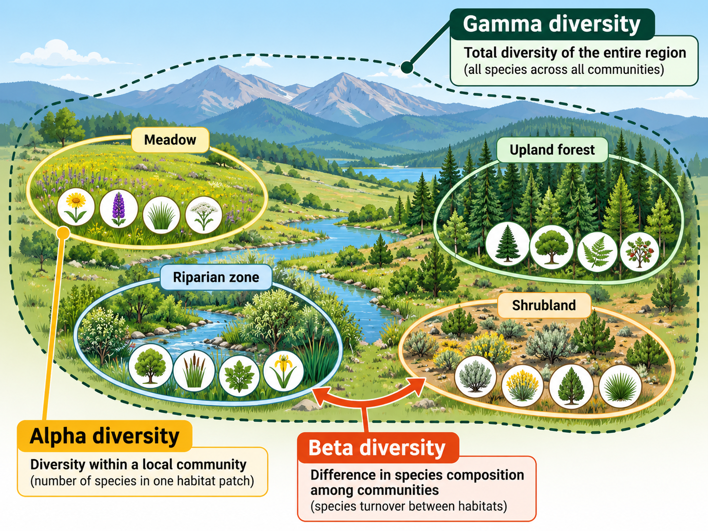
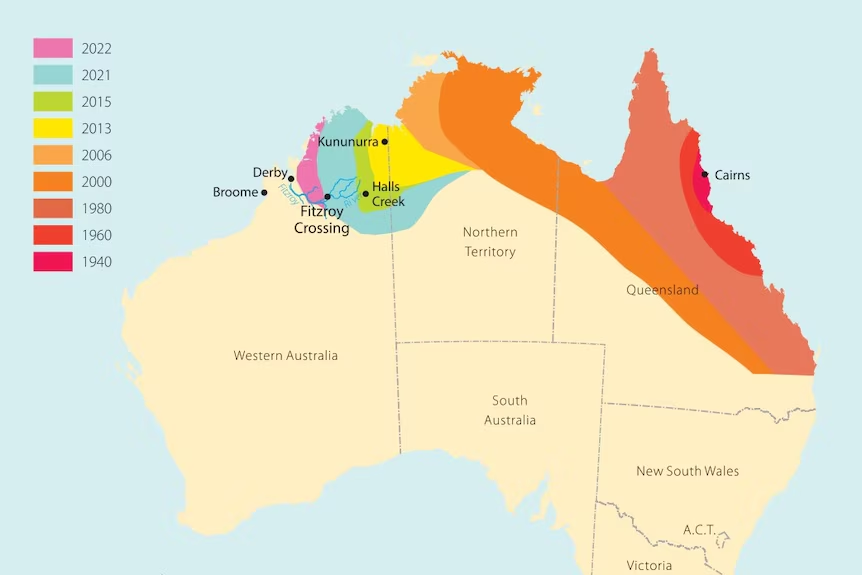
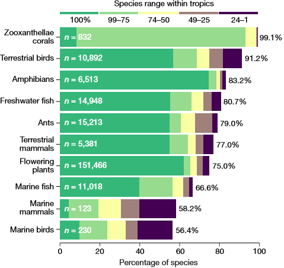
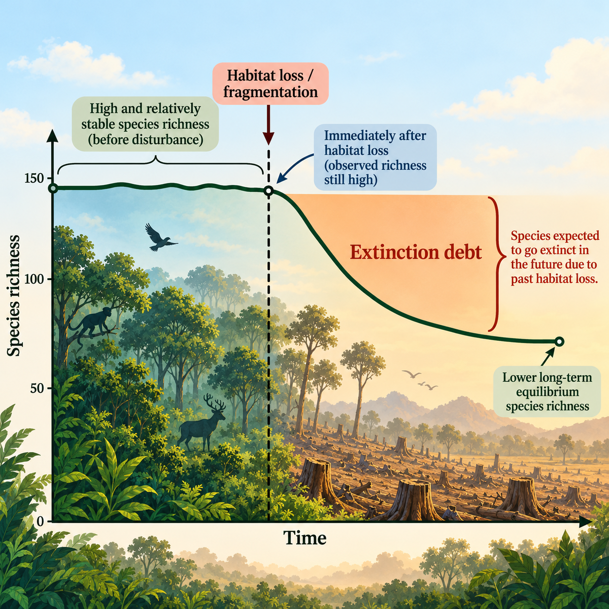
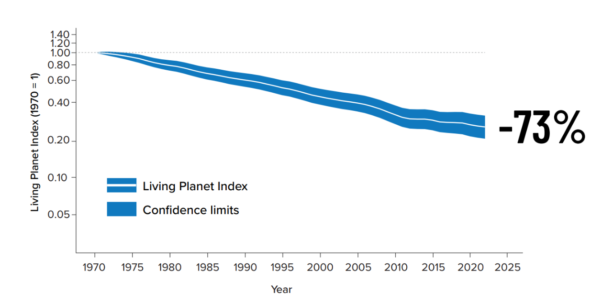

## 

## Diversity can buffer ecological systems against change

* **Functional redundancy = multiple species may contribute to similar ecosystem roles**
 
* **Response diversity = species performing similar roles may respond differently to disturbance**

    
 
 
 
 
 
 
 
 
 
 
 
 
 
 

* Biodiversity can influence:
    + resistance = how much a system changes
    + resilience = how quickly a system recovers

## Today's main topic: Species diversity

 

* **Intricate webs of interacting organisms**
    + ~2,000,000 species are known 
    + ~18,000 new species discovered per year
    + estimated >85% of species remain undescribed

 

* **Species diversity is only one dimension of biodiversity**
    + but it is the main focus of today

 

* **Humans are rapidly altering ecosystems**
    + aquatic and terrestrial
    + species losses now exceed background rates

 

## HOW: Measuring biodiversity (e.g. Simpson's index)

**Assumption: all species are treated as equally important**

## Spatial scale matters: alpha, beta, and gamma diversity

 

* **Alpha diversity**
    + diversity within a local community or site

 

* **Beta diversity**
    + turnover or compositional difference among communities

 

* **Gamma diversity**
    + total diversity across the broader region

 

* **The question, 'How diverse is the place?' requires spatial context**
    + can local richness increase while regional distinctness declines?
    

## Similar species diversity may not =  same ecological function

* **Richness and evenness describe species diversity**

 

* **But communities with similar species diversity may differ in:**
    + functional diversity
    + phylogenetic diversity
    + ecosystem function

 

* **Key implication:**
    + diversity indices summarize pattern
    + they do not fully tell us what organisms do
        + species identity/role matters

## WHO: Species types (native, endemic, non-native, invasive)

## Invasion is a process, not just a label

 

* **Introduced**
    + transported beyond natural range

 

* **Established**
    + self-sustaining population forms

 

* **Spreading**
    + population expands geographically

 

* **Invasive**
    + spread is accompanied by ecological or economic harm

## Management dilemmas: what exactly are we trying to conserve?

## Where: Species diversity generally declines from the tropics

## Why are the tropics so diverse?

 
 

* **The pattern is clear, but the explanation is not singular**

 

* **Major drivers include:**
    + More energy/productivity can support more species
    + Greater habitat heterogeneity creates more niches
    + Long-term climatic stability promotes persistence and diversification

 

* **Take home: broad diversity gradients reflect both ecological and evolutionary processes**

## Ecoregions: where biodiversity hotspots exist

**Diversity in the tropics is a broad global pattern—not a rule. High biodiversity and  high endemism occur outside the tropics because of isolation, topography, evolutionary history, or unusual environments.**

## Hotspots: How can mountains create biodiversity?

**Andean uplift created environmental heterogeneity, barriers to dispersal, and isolated habitats that promoted allopatric speciation and high endemism.**

## Hotspots: Endemic species of Madagascar

**PRACTICE: What factors contribute to the 90% endemism of Madagascar species?**

## Threats to biodiversity are additive and synergistic

* **Habitat loss and fragmentation**
    + smaller populations, isolation, reduced gene flow
 

* **Climate change**
    + range shifts, altered disturbance regimes, phenological mismatch
 

* **Species interactions can be disrupted**
    + loss of pollinators, hosts, prey, or mutualists can cause secondary declines
 

* **Overexploitation and food web disruption**
    + removal of functionally important species restructures communities
 

* **Invasive species and biotic homogenization**
    + replacement of distinct native communities by widespread generalists
 
  
* **Genetic erosion**
    + population bottlenecks reduce adaptive potential before species extinction occurs
    
 

**These threats rarely act independently — multiple stressors can interact and amplify biodiversity loss**

## Threats to biodiversity

## Humans drive species redistribution

 

* **Human movement of organisms overcomes biogeographic barriers**

 

* **Shipping, trade, travel, and intentional introductions accelerate spread**

 

* **Aquatic systems are especially vulnerable**

 

* **This redistribution is a major driver of invasive species problems**

## 

## Habitat loss, species-area relationships, and extinction debt

 

* **Larger areas tend to support more species**
    + S = cA^z^, where \(S\) is species richness and \(A\) is area.

 

* **Habitat loss therefore predicts species loss**

 

* **Extinction debt**
    + species may persist for a time after habitat is reduced
    + but eventual losses are still expected

 

* **Thus, lags exist between land-use change and biodiversity decline**

## Living Planet Index: population abundance is declining globally

* **Tracks changes in wild vertebrate population abundance**
    + 35,803 populations; 5,790 species

 

* **Average population abundance declined 73% since 1970**
    + freshwater populations: -85%

 

* **This is not a measure of species extinction**
    + warning signal of population decline

 

* **Trends are not universal**
    + some populations are stable or recovering

## Are we experiencing a new mass extinction?

 

* **Background extinction is a natural part of evolution**
    + <2 extinctions per million species per year

 

* **Current extinction rates are much higher**
    + estimated at 10-100s of times above long-term background rates
    + rates are still accelerating

 

* **Threatened does not mean doomed**
    + reducing pressures, protecting habitat, and restoring populations can prevent future extinctions

## Testable concepts

 

* **Biodiversity has multiple dimensions and scales**
    + species, functional, and genetic diversity; alpha, beta, and gamma diversity

 

* **Measuring biodiversity requires more than counting species**
    + richness, evenness, diversity indices, and the limits of those metrics

 

* **Biodiversity patterns reflect ecological and evolutionary processes**
    + latitudinal gradients, hotspots, endemism, isolation, and speciation

 

* **Human activities reshape biodiversity**
    + habitat loss, invasive species, homogenization, extinction risk, and extinction debt