## Matter is conserved — but ecosystems are open

 

* **Law of Conservation of Mass: Matter cannot be created or destroyed**
    + elements move among locations and change chemical form

 

* **At the global scale, matter is conserved**
    + C, N, P and other elements remain part of the Earth system

 

* **Individual ecosystems can gain or lose matter**
    + mineral nutrients enter and leave through water, air, organisms and disturbance

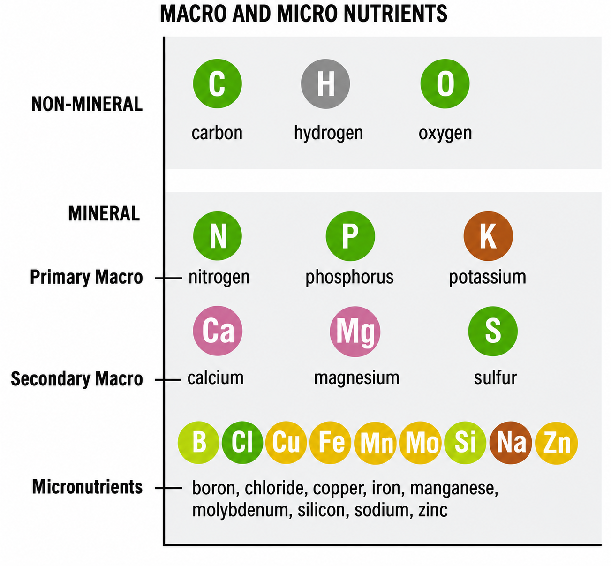

## Energy flows, but matter cycles

 

* **Energy moves directionally**
    + enters ecosystems largely as sunlight
    + ultimately leaves as heat

 

* **Matter is reused**
    + atoms move repeatedly between organisms and the physical environment

 

* Two major ecosystem processes:
    + **energy flow**
    + **matter cycling**

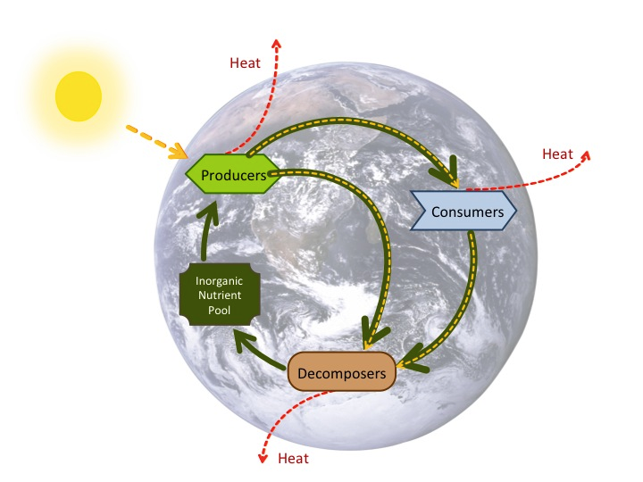

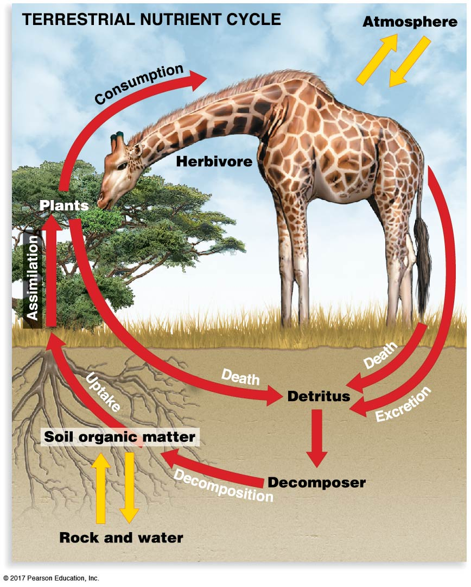

## How ecologists describe a biogeochemical cycle

* **Pool / stock = amount of an element stored in a location**

 

* **Flux = rate of movement between pools**

 

* **Transformation = change from one chemical form to another**

 

* **Residence time = how long matter tends to remain in a pool**

 

* **How much is there? How fast is it moving? What form is it in? How long does it stay?**
    + Large pool ≠ large flux

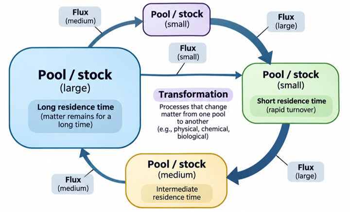

## Biological availability depends on chemical form

* **Abundance does not equal availability**

 

* **Nitrogen is abundant in the atmosphere**
    + most organisms cannot use N~2~ directly
    + plants primarily acquire NH~4~^+^ and NO~3~^-^

 

* **Elements can move between:**
    + inorganic forms
    + organic molecules
    + unavailable or slowly available pools

 

* **Transformations determine who can use an element**

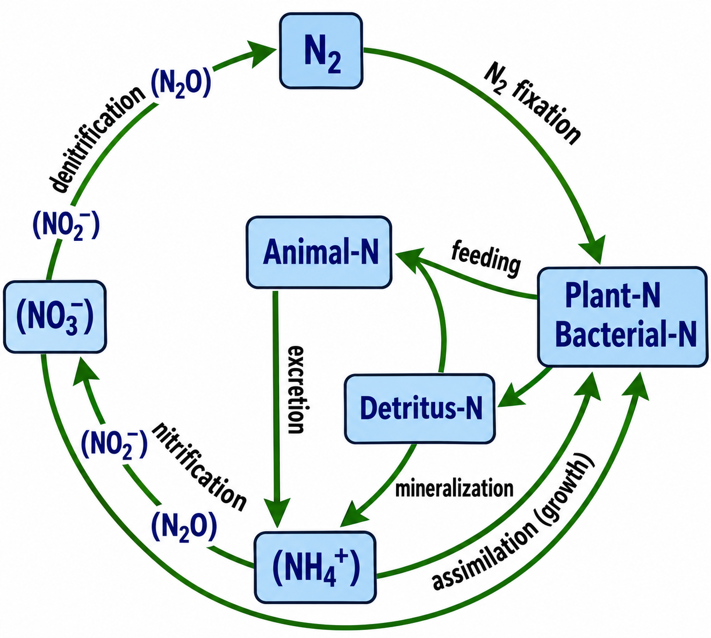

## Nutrient limitation constrains ecosystem productivity

* **Limiting nutrient**
    + resource whose availability constrains biological production

 

* **Limitation varies among ecosystems**
    + N limitation
    + P limitation
    + **co-limitation**

 

* **How do we test nutrient limitation?- manipulate nutrient supply:**  
    + control, +N,  +P, +N and +P
    + compare the biological response among treatment

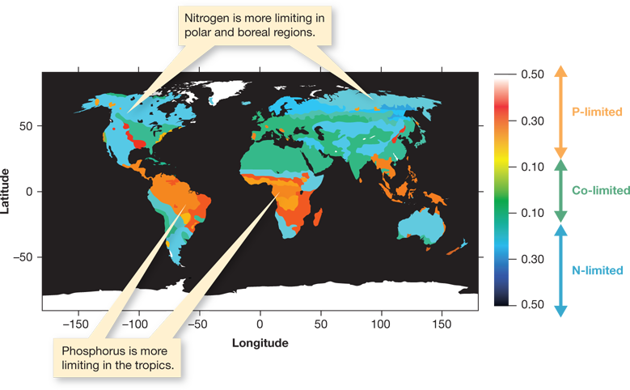

## Ecological stoichiometry: organisms need elements in ratios

* **Organisms do not need unlimited amounts of a single nutrient**
    + they require *C, N, P and other elements in particular proportions*

 

* **Elemental balance can influence:**
    + plant growth
    + food quality
    + decomposition
    + nutrient recycling

 

* **A surplus of one element cannot always compensate for shortage of another**

 

* **Growth depends on the balance among elements, not just the absolute amount of one nutrient**

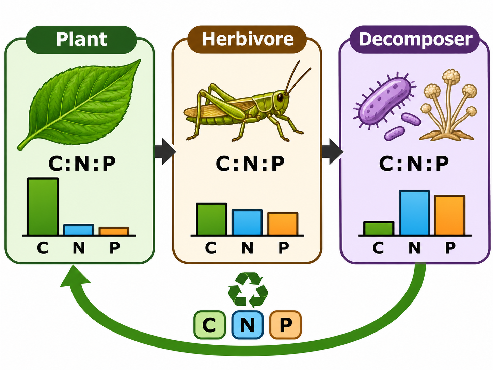

## Biogeochemical cycles operate across global reservoirs

* **Atmosphere • Hydrosphere • Lithosphere • Biosphere • Cryosphere**

 
 
 

* **Reservoirs differ in:**
    + amount stored
    + chemical form
    + residence time
    + rates of exchange with other reservoirs

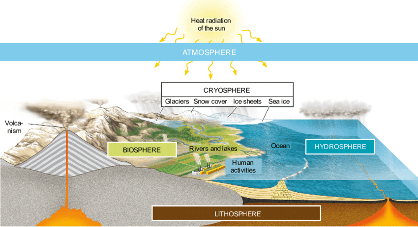

## Nutrient cycles: Ecosystem budgets

* **Inputs**
    + fixation
    + weathering
    + atmospheric deposition

 

* **Internal recycling**
    + food webs
    + decomposition
    + biological uptake

 

* **Outputs**
    + gaseous losses
    + leaching / runoff
    + erosion and disturbance

 

**Change in storage = inputs − outputs**

 

* Disturbance can increase nutrient loss
    + recovery can increase nutrient retention

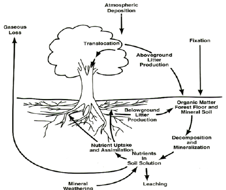

## Carbon cycle: Ecosystem pools and fluxes

* **Photosynthesis transfers atmospheric or aquatic CO~2~ into organic carbon**
* **Respiration and decomposition return carbon to inorganic forms**
* **Carbon can be stored for very different lengths of time in biomass, soils, oceans and sediments**
* **How much is there? How fast is it moving? What form is it in? How long does it stay?**

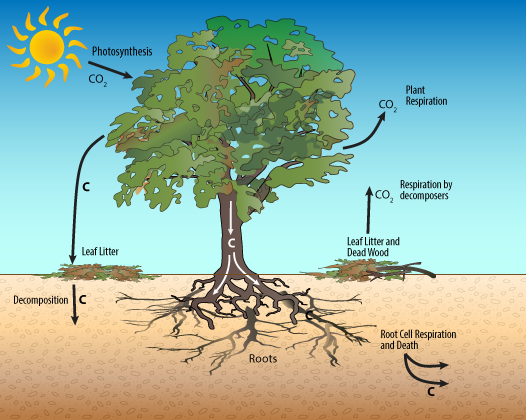

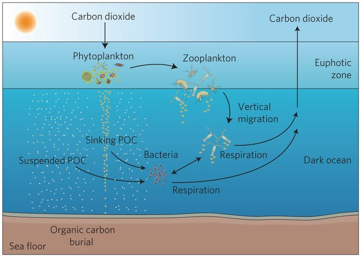

## Carbon storage and movement

* **Reservoir / pool = stores carbon**

 

* **Source = releases more carbon than it absorbs**

 

* **Sink = absorbs more carbon than it releases**

 

* **These terms are not interchangeable**
    + a large reservoir is not necessarily a strong sink

 

* **A system can shift between source and sink through time**
    + especially with human activities

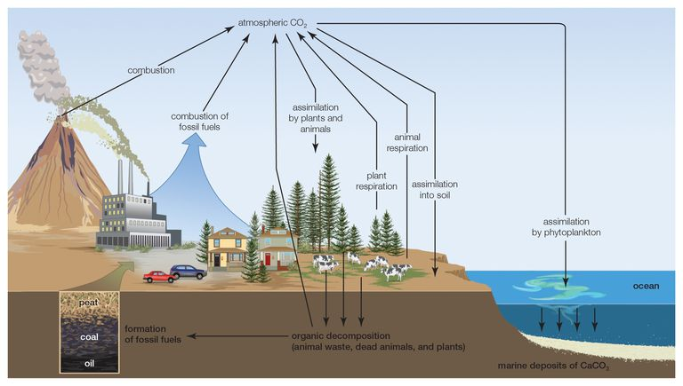

## Humans have greatly altered the global carbon budget

* **Fossil fuels and land-use change move carbon into the atmosphere**

 
 
 
 

* **2015–2024 average:**
    + Ocean sink ≈ 29%
    + Land sink ≈ 21%
    + ~50% remains in the atmosphere

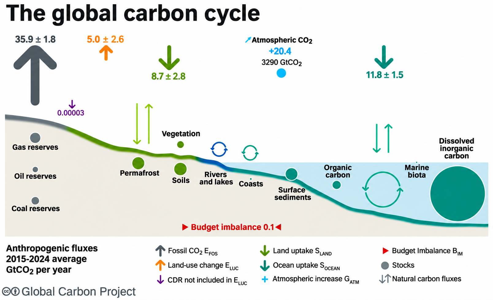

## Carbon sinks are dynamic — not limitless

 

* **Sink strength changes through time**
    + climate variability
    + drought and fire
    + warming
    + land-use change

 

* **Storage and sink strength are different**
    + a reservoir may contain enormous amounts of carbon without currently gaining carbon rapidly

 

* **Ocean acidification occurs partly because oceans are absorbing CO~2~**
    + it does not mean oceans have stopped storing carbon

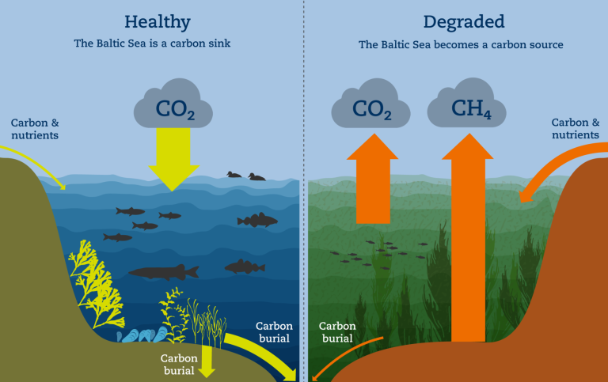

## Nitrogen: abundant but often unavailable

* **~78% of the atmosphere is N~2~**

 

* **Most organisms cannot directly use atmospheric N~2~**
    + however, nitrogen demand is high

 

* **Microorganisms control many key transformations**
    + generate biologically available forms
    + recycle nitrogen
    + return nitrogen to the atmosphere

 

* **Nitrogen cycling therefore depends strongly on microbial metabolism**

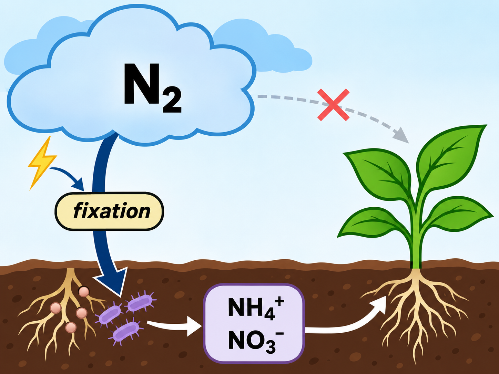

## Nitrogen changes form through microbial transformations

**Microbial transformations move nitrogen among atmospheric, inorganic, and organic pools, controlling its biological availability and return to the atmosphere**

 

* **Nitrogen fixation**
    + N~2~ → NH~3~ / NH~4~^+^
 

* **Nitrification**
    + NH~4~^+^ → NO~2~^-^ → NO~3~^-^
 

* **Assimilation**
    + inorganic N → organic biomass
 

* **Mineralization**
    + organic N → NH~4~^+^
 

* **Denitrification**
    + NO~3~^-^ → N~2~ / N~2~O

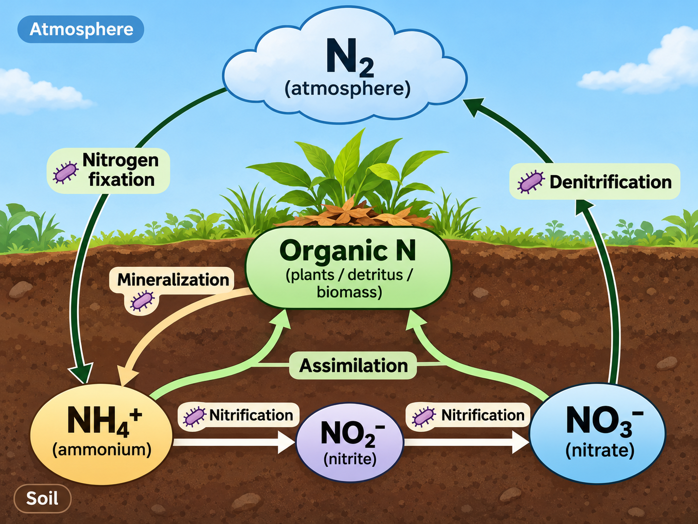

## Mineral nutrients cycle very differently

<
br/>

* **Nitrogen**
    * large atmospheric reservoir
    * strong microbial control
    * multiple gaseous pathways
    * can enter ecosystems through biological fixation
    * can be lost through denitrification and leaching

* **Phosphorus**
    * major reservoirs in rocks, soils and sediments
    * no major atmospheric gaseous reservoir
    * weathering is an important long-term input
    * strong binding to soils and minerals
    * loss through runoff, erosion and export

 

* **All essential mineral nutrients cycle through ecosystems.**
    + macronutrients (N, P, K, Ca, Mg, S) and micronutrients (Fe, Mn, Zn, Cu, etc.) move among organisms and environmental reservoirs.
    + each cycle can be described by where the nutrient is stored, how it becomes available, and how it is retained or lost.

## Decomposition drives internal nutrient recycling

 
 

* **Decomposition = breakdown of dead organic matter**

 

* **Mineralization = organic nutrients → inorganic forms**

 

* **Immobilization = microbes incorporate inorganic nutrients into microbial biomass**

 
 
 

* **Decomposition does not always mean nutrients become immediately available to plants**

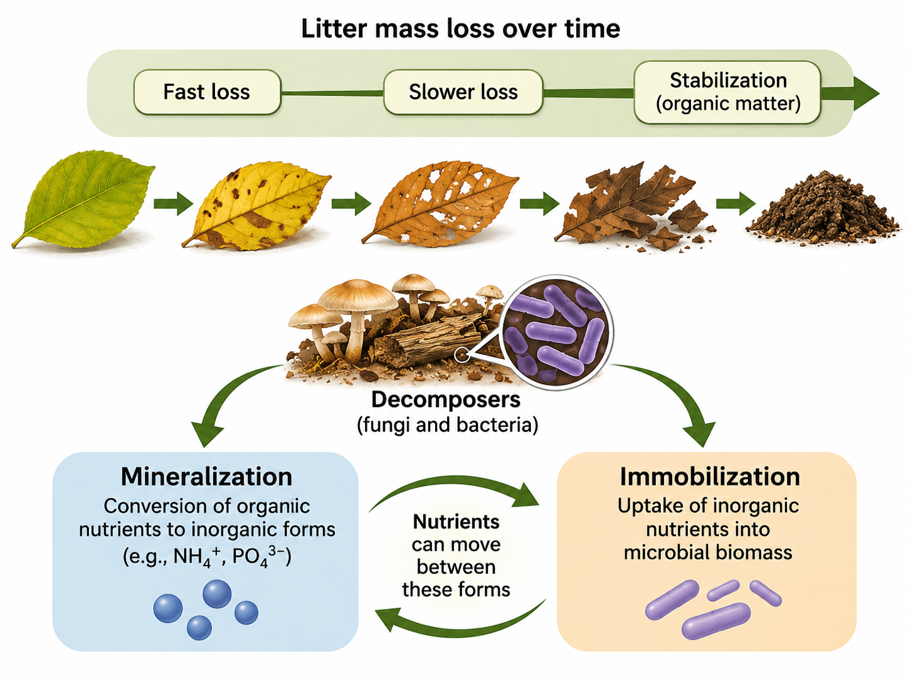

## What controls decomposition rate?

**Climate × substrate quality × decomposer community**

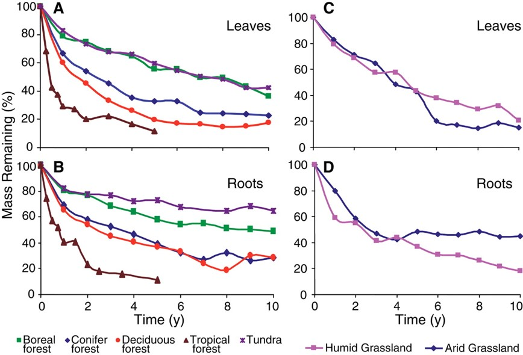 

## Soil communities regulate nutrients

 

* **Microbes transform nutrients among chemical forms**

 

* **Plants and microbes compete for available nutrients**

 

* **Mycorrhizal fungi**
    + extend the effective nutrient-absorbing surface of roots
    + exchange nutrients for plant carbon

 
 

* **Belowground interactions can strongly control ecosystem nutrient retention**

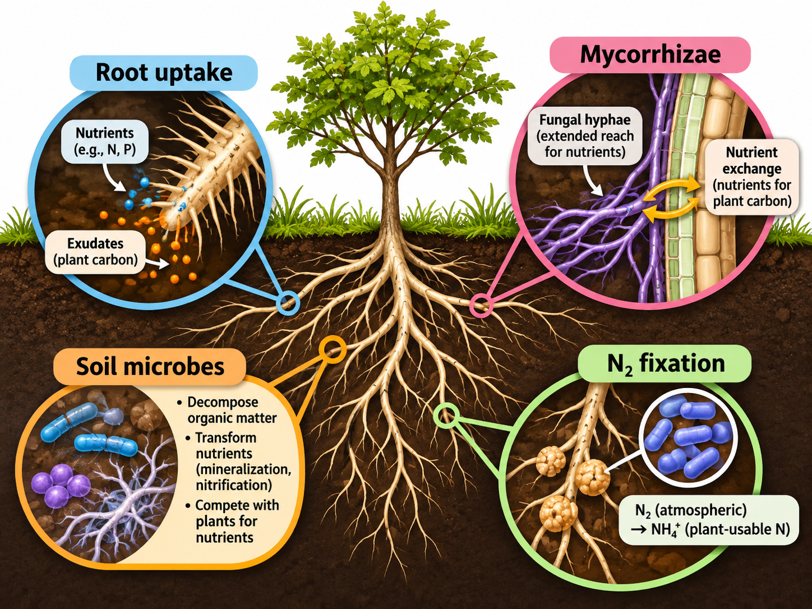

## Humans accelerate nutrient inputs and exports

* **Haber–Bosch = industrial conversion of N~2~ into reactive nitrogen**

 

* **Fertilizer and manure increase N and P inputs**

 

* **Excess nutrients can leave terrestrial ecosystems**
    + runoff
    + leaching
    + gaseous losses

 

* **Eutrophication**
    + nutrient enrichment → algal production → decomposition → O~2~ depletion

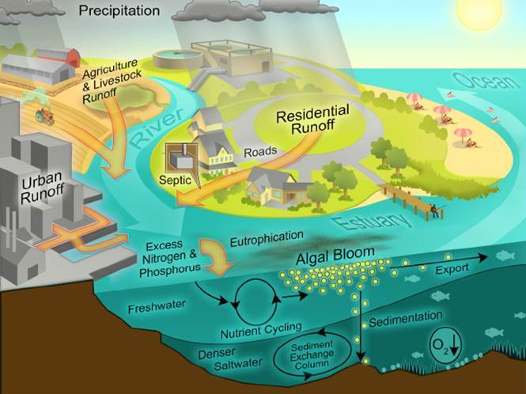

## Primary productivity is a flux — not a pool

 

* **Gross primary production (GPP)**
    + total carbon fixed by primary producers

 

* **Some fixed carbon is used in autotrophic respiration**

 

* **Net primary production (NPP)**
    + new producer biomass generated per unit time

 

* **Standing biomass is a pool**
* **NPP is a rate / flux**

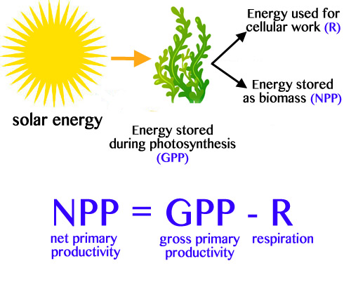

## Global NPP depends on both productivity and area

**High productivity per unit area does not necessarily mean large global contribution**

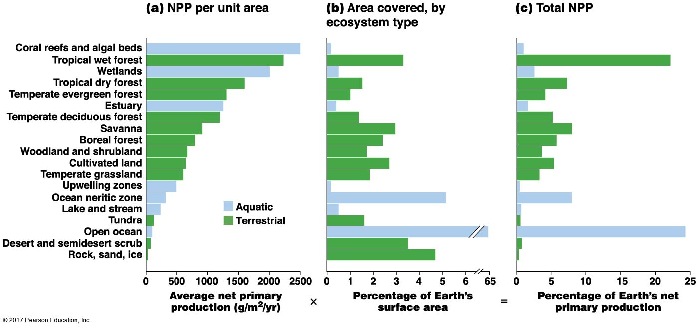

## Testable concepts

 

* **Matter cycling and ecosystem budgets**
    + pools, fluxes, transformations, residence time, inputs, outputs, and nutrient retention

 

* **Nutrient availability and limitation**
    + chemical form, N and P limitation, co-limitation, and ecological stoichiometry

 

* **Carbon and nitrogen cycling**
    + reservoirs, sources and sinks, microbial transformations, and human alteration of global cycles

 

* **Decomposition and primary productivity**
    + mineralization, controls on decomposition, GPP vs. NPP, and pool vs. flux