## Matter is conserved — but ecosystems are open

* **Matter cannot be created or destroyed**
    + elements move among locations and change chemical form

* **At the global scale, matter is conserved**
    + C, N, P and other elements remain part of the Earth system

* **Individual ecosystems can gain or lose matter**
    + nutrients enter and leave through water, air, organisms and disturbance

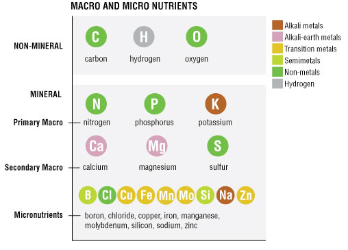

## Energy flows, but matter cycles

* **Energy moves directionally**
    + enters ecosystems largely as sunlight
    + ultimately leaves as heat

 

* **Matter is reused**
    + atoms move repeatedly between organisms and the physical environment

 

* Two major ecosystem processes:
    + **energy flow**
    + **matter cycling**

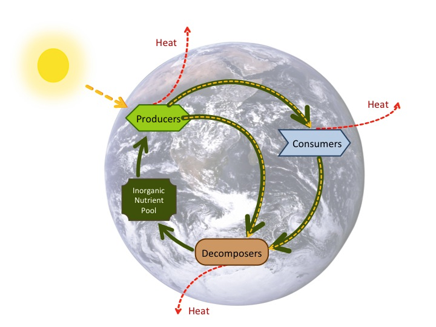

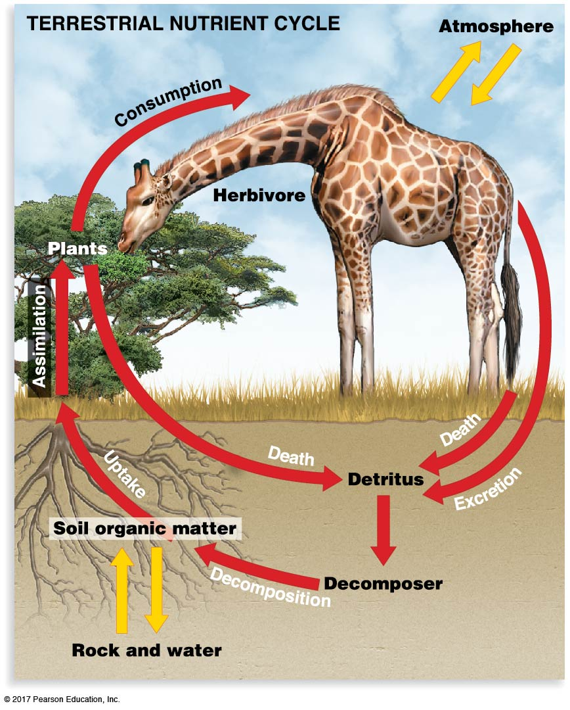

## How ecologists describe a biogeochemical cycle

* **Pool / stock**
    + amount of an element stored in a location

 

* **Flux**
    + rate of movement between pools

 

* **Transformation**
    + change from one chemical form to another

 

* **Residence time**
    + how long matter tends to remain in a pool

 

**Large pool ≠ large flux**

## Biological availability depends on chemical form

* **Abundance does not equal availability**

 

* Nitrogen is abundant in the atmosphere
    + most organisms cannot use N~2~ directly
    + plants primarily acquire NH~4~^+^ and NO~3~^-^

 

* Elements can move between:
    + inorganic forms
    + organic molecules
    + unavailable or slowly available pools

 

* **Transformations determine who can use an element**

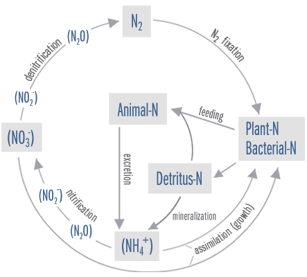

## Nutrient limitation constrains ecosystem productivity

* **Limiting nutrient**
    + resource whose availability constrains biological production

 

* Limitation varies among ecosystems
    + N limitation
    + P limitation
    + **co-limitation**

 

* How would we test limitation?

<table style="font-size:80%; width:90%; text-align:center;">
<tr><td>Control</td><td>+ N</td></tr>
<tr><td>+ P</td><td>+ N + P</td></tr>
</table>

 

* Compare the biological response among treatments

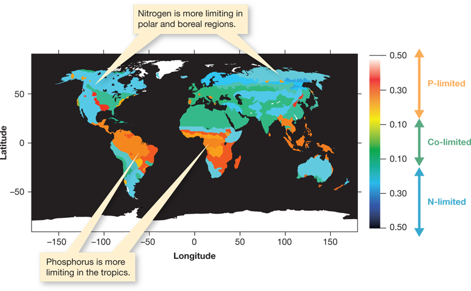

## Ecological stoichiometry: organisms need elements in ratios

* Organisms do not need unlimited amounts of a single nutrient
    + they require **C, N, P and other elements in particular proportions**

 

* Elemental balance can influence:
    + plant growth
    + food quality
    + decomposition
    + nutrient recycling

 

* **A surplus of one element cannot always compensate for shortage of another**

## Biogeochemical cycles operate across global reservoirs

* **Atmosphere • Hydrosphere • Lithosphere • Biosphere • Cryosphere**

* Reservoirs differ in:
    + amount stored
    + chemical form
    + residence time
    + rates of exchange with other reservoirs

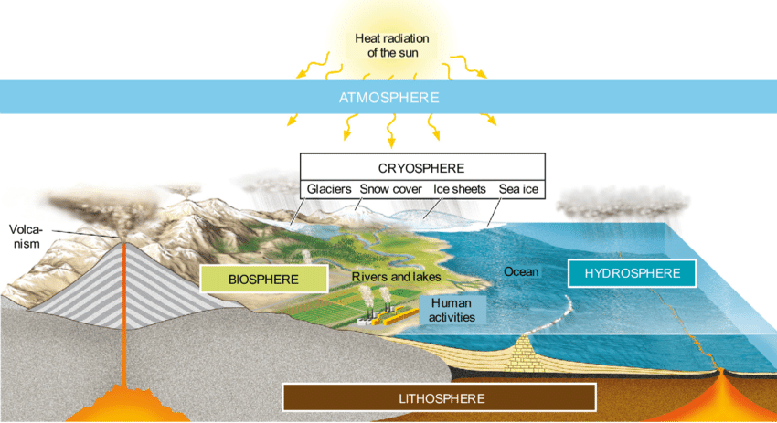

## Nutrient cycles: Ecosystem budgets

* **Inputs**
    + fixation
    + weathering
    + atmospheric deposition

 

* **Internal recycling**
    + food webs
    + decomposition
    + biological uptake

 

* **Outputs**
    + gaseous losses
    + leaching / runoff
    + erosion and disturbance

 

**Change in storage = inputs − outputs**

 

* Disturbance can increase nutrient loss
    + recovery can increase nutrient retention

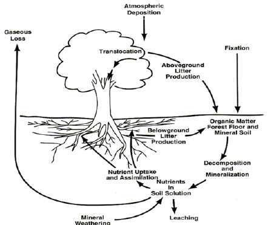

## Carbon cycle: Ecosystem pools and fluxes

* **Photosynthesis transfers atmospheric or aquatic CO~2~ into organic carbon**
* **Respiration and decomposition return carbon to inorganic forms**
* Carbon can be stored for very different lengths of time in biomass, soils, oceans and sediments

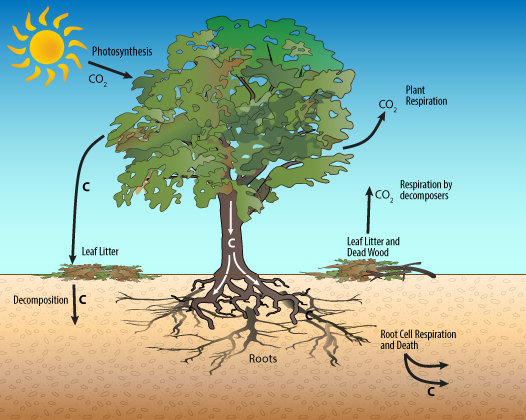

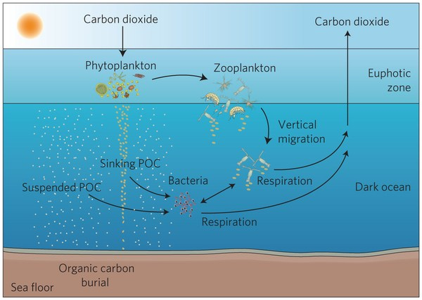

## Carbon reservoir, source, or sink?

* **Reservoir / pool**
    + stores carbon

 

* **Source**
    + releases more carbon than it absorbs

 

* **Sink**
    + absorbs more carbon than it releases

 

* These terms are not interchangeable
    + a large reservoir is not necessarily a strong sink

 

* A system can shift between source and sink through time

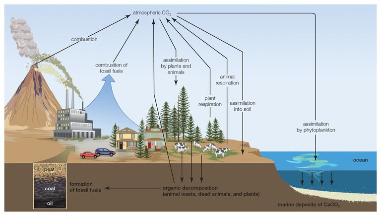

## Humans have altered the global carbon budget

* Fossil fuels and land-use change move carbon into the atmosphere

 

* Natural sinks remove only part of those emissions

 

* 2015–2024 average:
    + **Ocean sink ≈ 29%**
    + **Land sink ≈ 21%**

 

* The remainder largely accumulates in the atmosphere

 

Global Carbon Budget 2025

## Carbon sinks are dynamic — not limitless

* Sink strength changes through time
    + climate variability
    + drought and fire
    + warming
    + land-use change

 

* **Storage and sink strength are different**
    + a reservoir may contain enormous amounts of carbon without currently gaining carbon rapidly

 

* Ocean acidification occurs partly because oceans are **absorbing CO~2~**
    + it does not mean oceans have stopped storing carbon

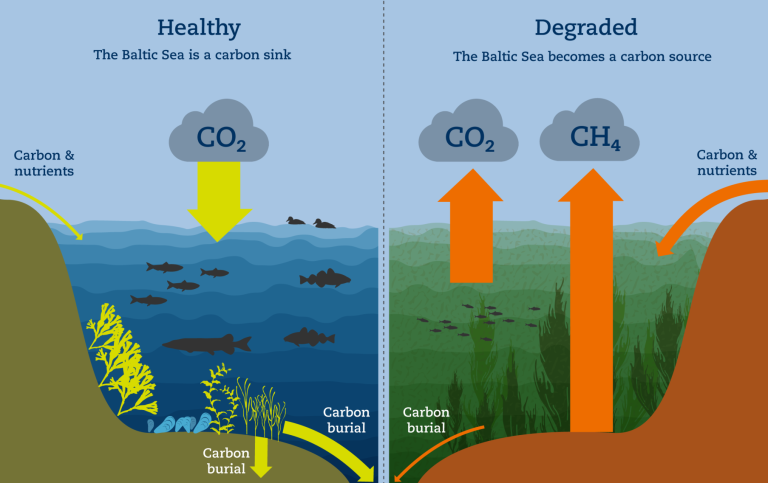

## Nitrogen: abundant but often unavailable

* ~78% of the atmosphere is N~2~

 

* Most organisms cannot directly use atmospheric N~2~

 

* **Microorganisms control many key transformations**
    + generate biologically available forms
    + recycle nitrogen
    + return nitrogen to the atmosphere

 

* Nitrogen cycling therefore depends strongly on microbial metabolism

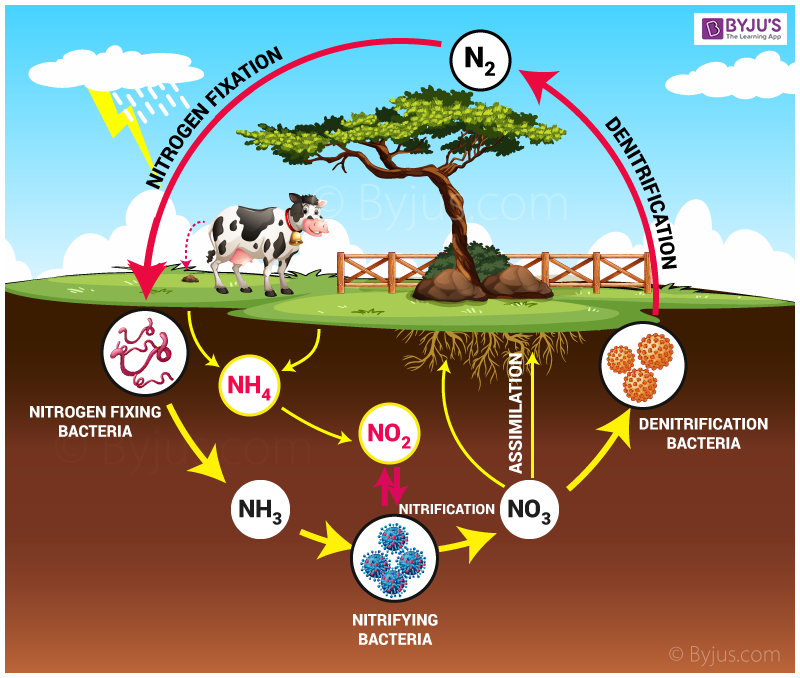

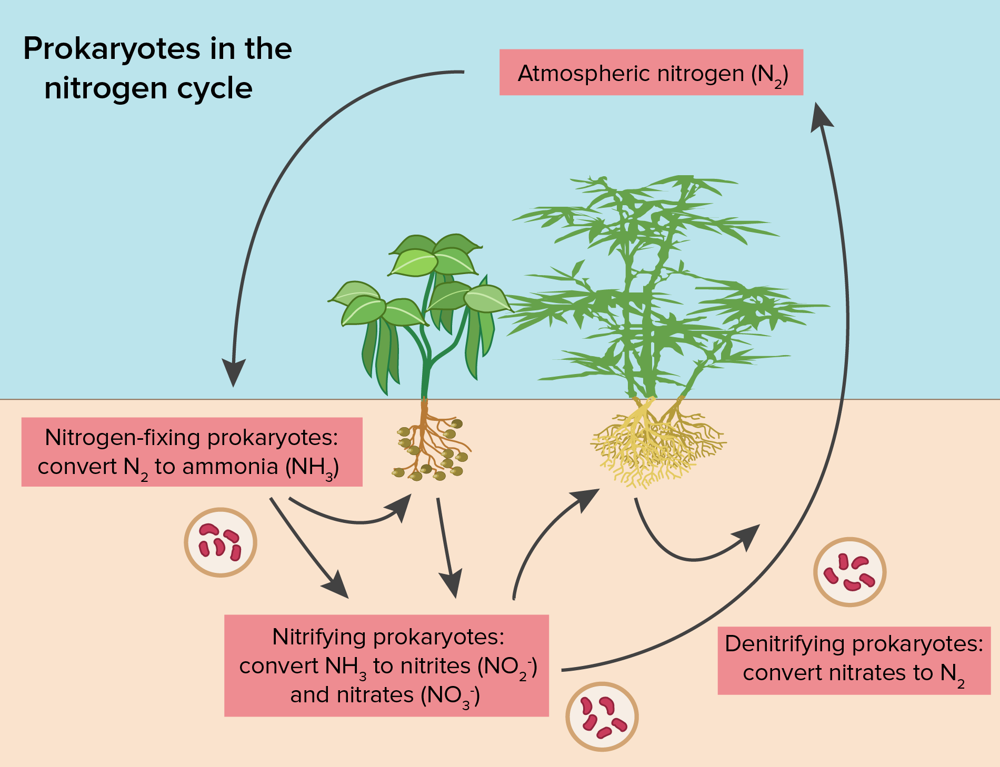

## Nitrogen changes form through microbial transformations

* **Nitrogen fixation**
    + N~2~ → NH~3~ / NH~4~^+^

* **Nitrification**
    + NH~4~^+^ → NO~2~^-^ → NO~3~^-^

* **Assimilation**
    + inorganic N → organic biomass

* **Mineralization**
    + organic N → NH~4~^+^

* **Denitrification**
    + NO~3~^-^ → N~2~ / N~2~O

## Nitrogen and phosphorus cycle very differently

### Nitrogen

* Large atmospheric reservoir
* Strong microbial control
* Multiple gaseous pathways
* Can enter ecosystems through biological fixation
* Can be lost through denitrification and leaching

### Phosphorus

* Major reservoirs in rocks, soils and sediments
* No major atmospheric gaseous reservoir
* Weathering is an important long-term input
* Strong binding to soils and minerals
* Loss through runoff, erosion and export

## Decomposition drives internal nutrient recycling

* **Decomposition**
    + breakdown of dead organic matter

 

* **Mineralization**
    + organic nutrients → inorganic forms

 

* **Immobilization**
    + microbes incorporate inorganic nutrients into microbial biomass

 

* Decomposition does not always mean nutrients become immediately available to plants

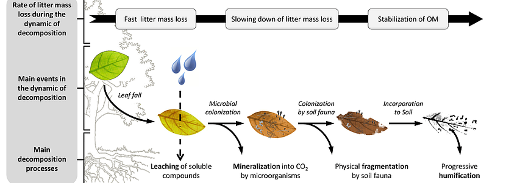

## What controls decomposition rate?

**Climate × substrate quality × decomposer community**

 

* Warm, moist conditions generally accelerate biological activity
* Litter chemistry matters
    + C:N ratio
    + lignin and other structural compounds
* Fungi, bacteria and detritivores differ among ecosystems

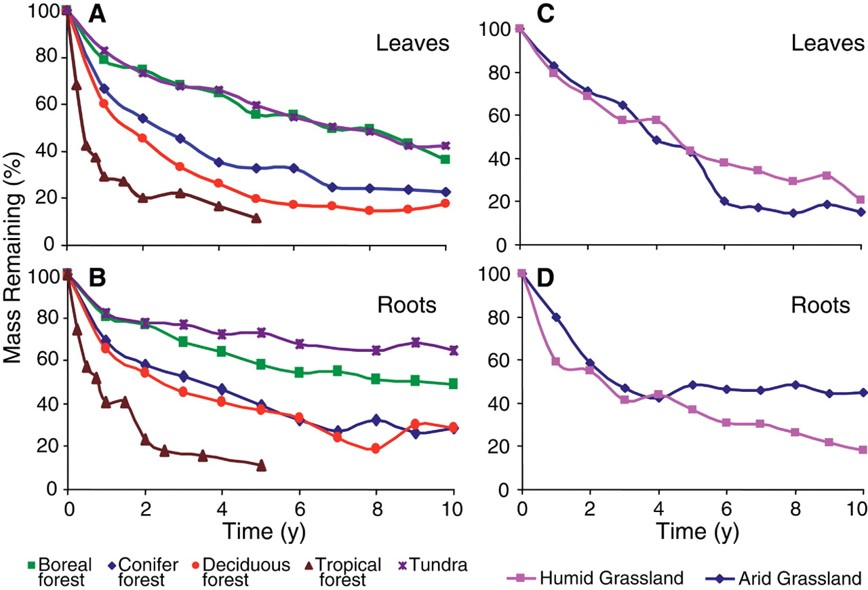 

## The soil community controls nutrient transformations and uptake

* Microbes transform nutrients among chemical forms

 

* Plants and microbes compete for available nutrients

 

* **Mycorrhizal fungi**
    + extend the effective nutrient-absorbing surface of roots
    + exchange nutrients for plant carbon

 

* Belowground interactions can strongly control ecosystem nutrient retention

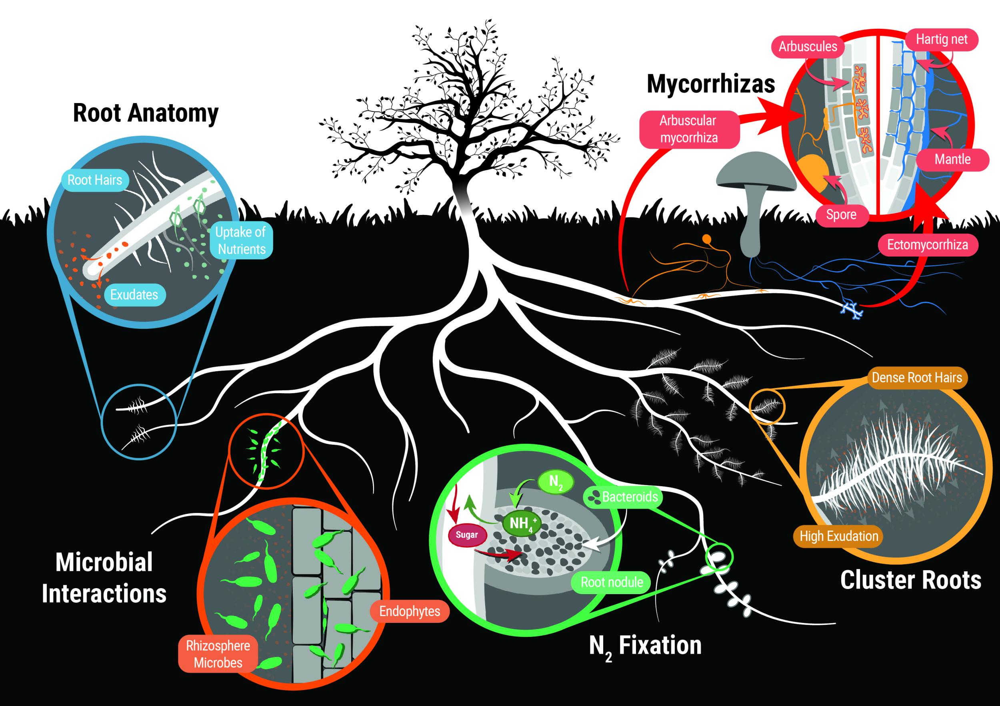

## Humans accelerate nutrient inputs and exports

* **Haber–Bosch**
    + industrial conversion of N~2~ into reactive nitrogen

 

* Fertilizer and manure increase N and P inputs

 

* Excess nutrients can leave terrestrial ecosystems
    + runoff
    + leaching
    + gaseous losses

 

* **Eutrophication**
    + nutrient enrichment → algal production → decomposition → O~2~ depletion

 

* Lake Erie harmful algal blooms are strongly linked to **phosphorus loading**

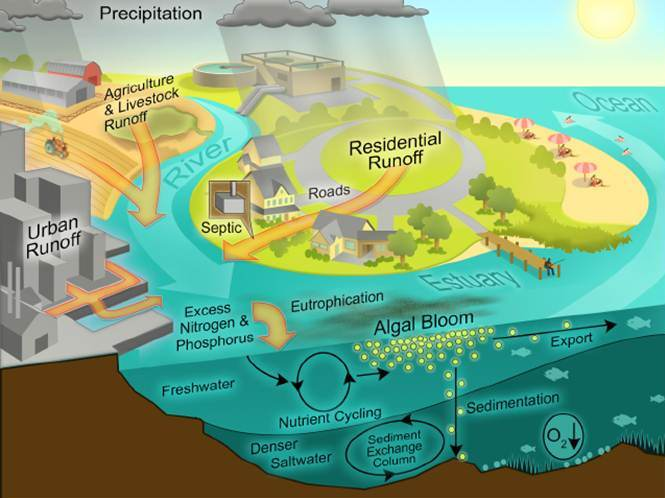

## Primary productivity is a flux — not a pool

* **Gross primary production (GPP)**
    + total carbon fixed by primary producers

 

* Some fixed carbon is used in autotrophic respiration

 

* **Net primary production (NPP)**
    + new producer biomass generated per unit time

 

### NPP = GPP − R

 

* **Standing biomass is a pool**
* **NPP is a rate / flux**

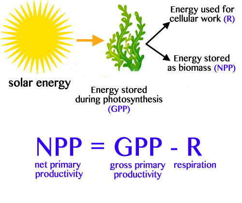

## Global NPP depends on both productivity and area

* **High productivity per unit area does not necessarily mean large global contribution**

* Total ecosystem contribution depends on:
    + NPP per unit area
    + area occupied

* **Pool vs. flux matters again**
    + phytoplankton maintain relatively little standing biomass but turn over rapidly
    + forests contain enormous biomass pools, but biomass and annual NPP are not the same thing

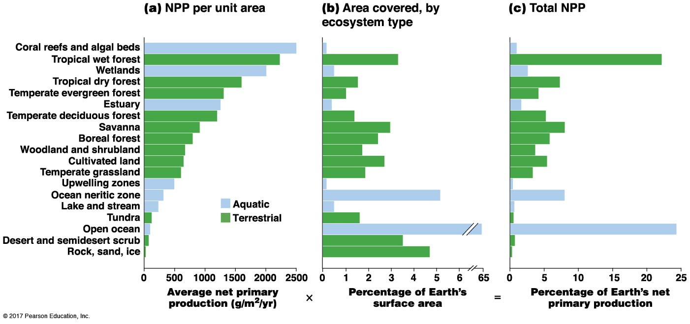

## Testable concepts

 

* **Matter cycling and ecosystem budgets**
    + pools, fluxes, transformations, residence time, inputs, outputs, and nutrient retention

 

* **Nutrient availability and limitation**
    + chemical form, N and P limitation, co-limitation, and ecological stoichiometry

 

* **Carbon and nitrogen cycling**
    + reservoirs, sources and sinks, microbial transformations, and human alteration of global cycles

 

* **Decomposition and primary productivity**
    + mineralization, controls on decomposition, GPP vs. NPP, and pool vs. flux