##

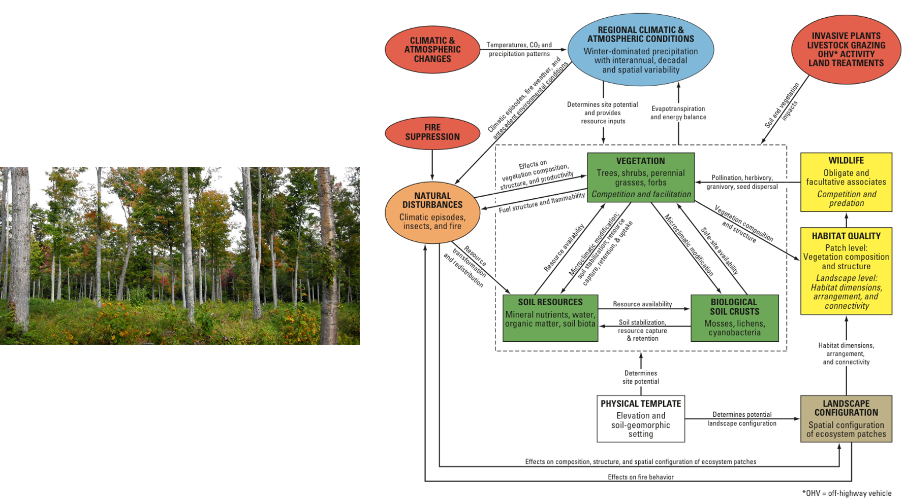

## Community assembly: How new communites form

 

* **Regional species pool**
    + many species could potentially occur here

 

* **Community assembly works like a series of filters:**
    + Can it get there? — *dispersal limits*
    + Can it survive there? — *abiotic conditions*
    + Can it persist with other species? — *biotic interactions*

 

* **Local communities reflect ecology + history**
    + chance and arrival order can also matter

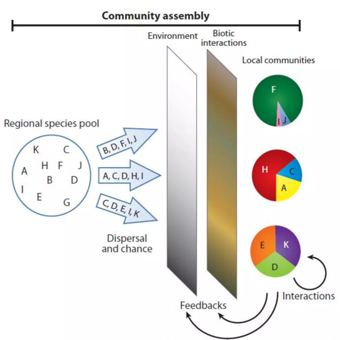

## Diverse communities broaden ecosystem function

* **Ecosystem function = the biological and physical processes that move energy and matter through an ecosystem**
    + productivity (biomass)
    + decomposition
    + nutrient cycling
    + energy transfer through food webs

 

* **Why can diversity increase function?**
    + **Complementarity:** species use resources differently
    + **Selection effect:** diverse communities are more likely to contain highly influential species

 

* **Biodiversity can also provide insurance**
    + different species respond differently to environmental change

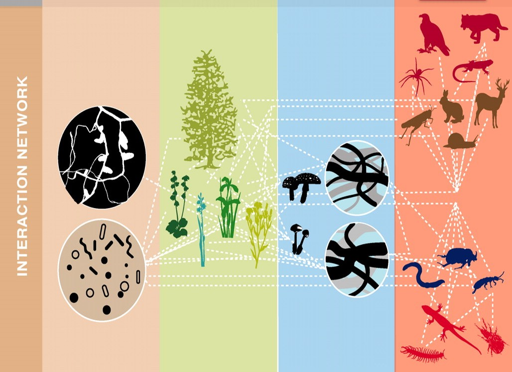

## Community stability has multiple dimensions

* **Ball-and-cup model = community stability reflects how strongly a system tends to return to its prior state after disturbance**

 

* **Resistance**
    + how little a community changes during disturbance

 

* **Resilience**
    + how well or how quickly a community recovers

 

* **Stability does not mean "no change"**
    + communities fluctuate through time
    + biodiversity can increase the range of conditions they tolerate

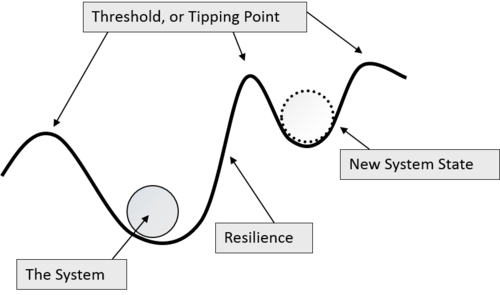

## Alternative stable states and ecological thresholds

* **Threshold / tipping point: enough environmental change can push a system into another state**

 
 
 
 
 
 
 
 
 
 
 
 
 
 
 
 
 

* **Recovery may not simply reverse the original pathway**
    + crossing a threshold can make restoration difficult

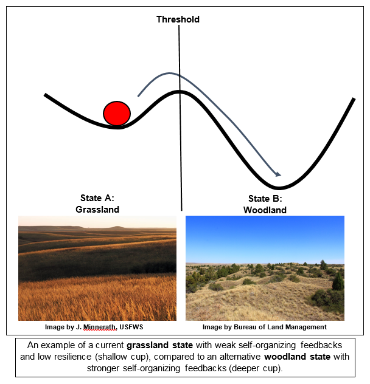

## Species can be important for very different reasons

 

* **Dominant / foundation species**
    + strong effects often result from abundance or physical structure

 

* **Keystone species**
    + disproportionately large ecological effect relative to abundance
    + classic example: sea stars in rocky intertidal communities

 

* **Ecosystem engineers**
    + modify the physical environment
    + e.g., beavers, corals

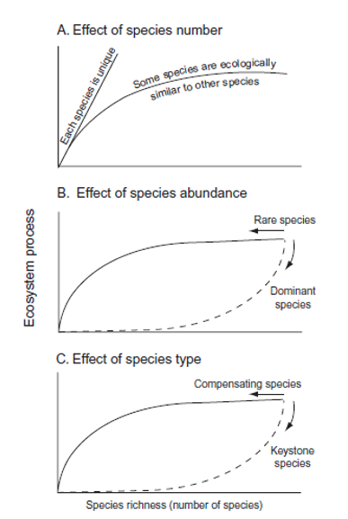

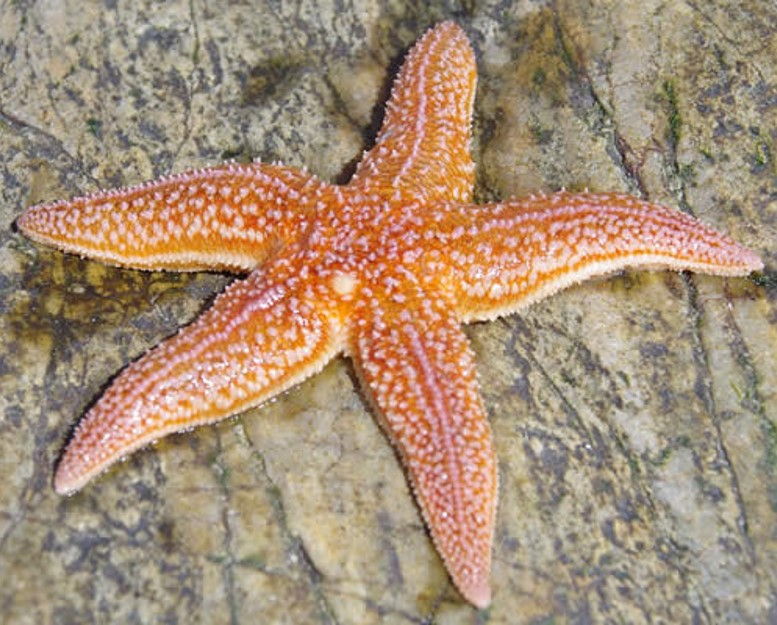

## Food webs are interaction networks

 

* **Food webs describe feeding relationships**
    + species are connected across trophic levels

 

* **Real food webs are not simple ladders**
    + omnivory is common
    + species differ in interaction strength
    + indirect effects can 'cascade' through the network

 

* **Changing one species can affect species it never directly interacts with**

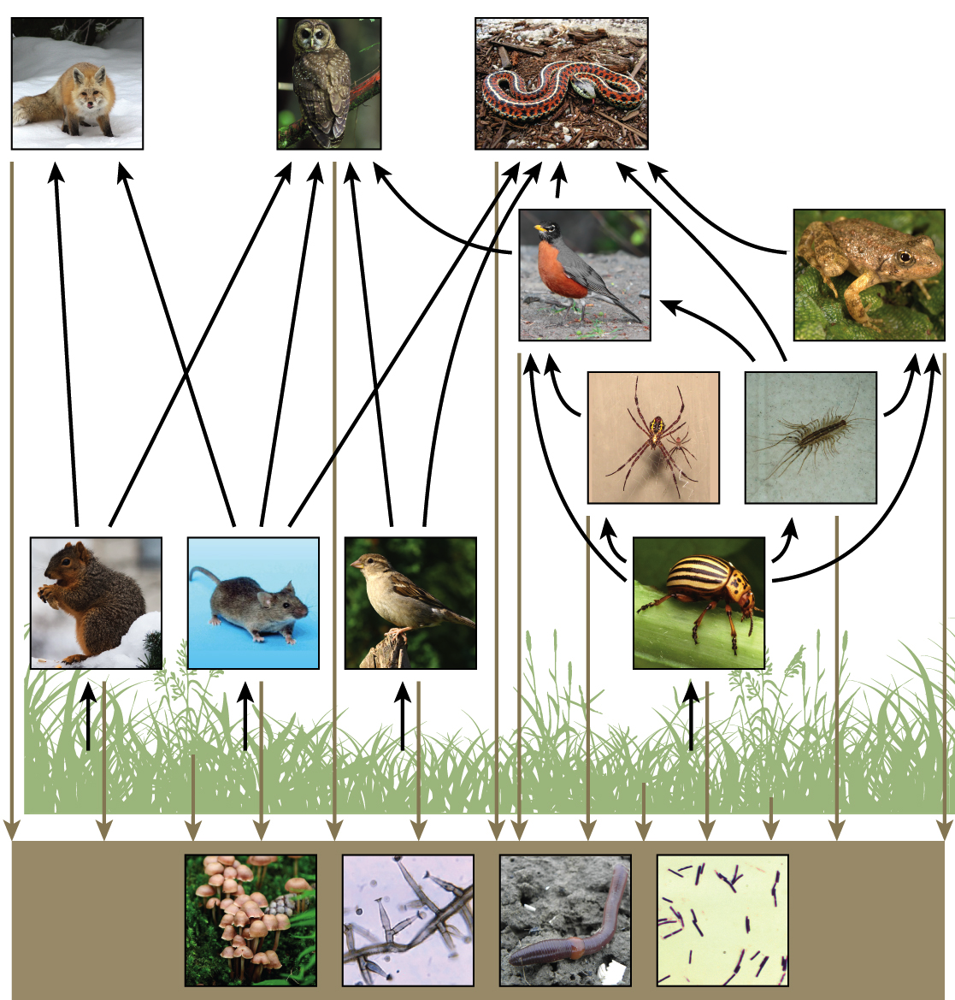

## Energy flow constrains food-chain length

* **Energy transfer between trophic levels is inefficient**
    + only energy stored as new biomass is available to the next trophic level

* **~10% transfer is a useful rule of thumb — not a biological constant**
    + efficiency varies among organisms and ecosystems

* **Decomposers are not simply a level "below" producers**
    + detrital pathways receive material from every trophic level

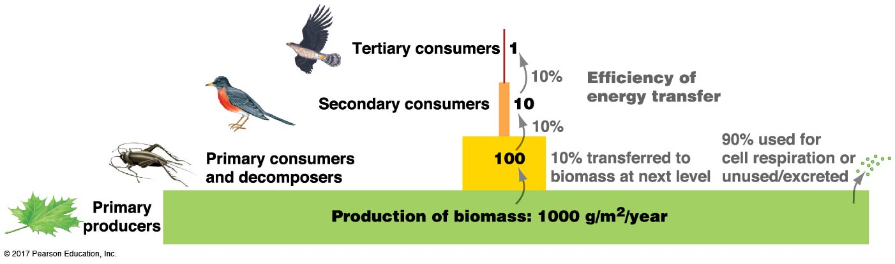

## Trophic cascades: indirect effects across a food web

* **Trophic cascade: A change at one trophic level produces effects across multiple trophic links**
    * predator → herbivore → producer
    * community effects can occur without direct interaction
    * strong cascades can restructure entire habitats

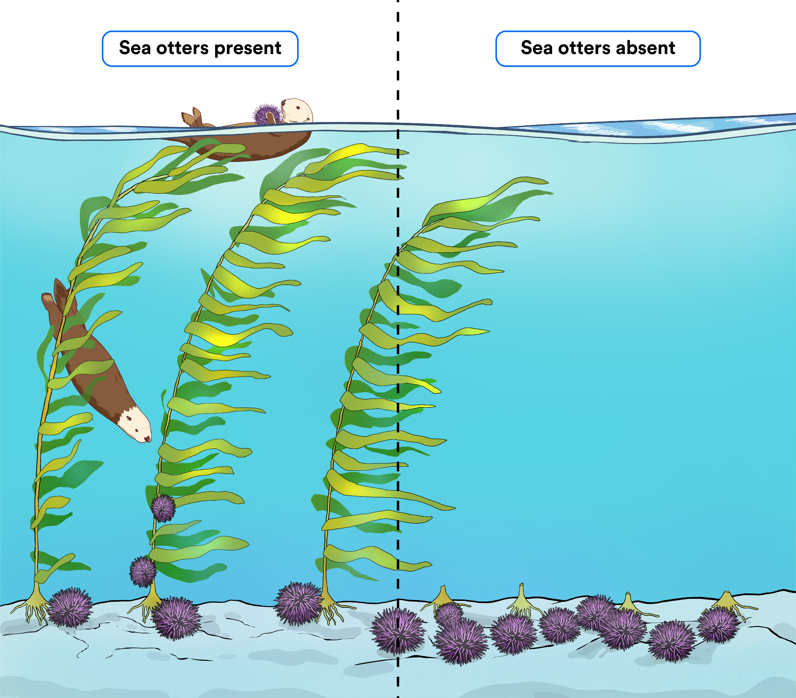

## Yellowstone wolves: evidence for top-down control?

* **Predicted cascade**
    + wolves ↓ elk abundance / alter elk behavior
    + reduced browsing
    + willow & aspen recovery
    + consequences for beavers and other species

 

* **Top-down control is only part of the story**
    + willow recovery also depends on water availability, climate, and other controls

 

* **Take home:** Community structure is controlled from both directions

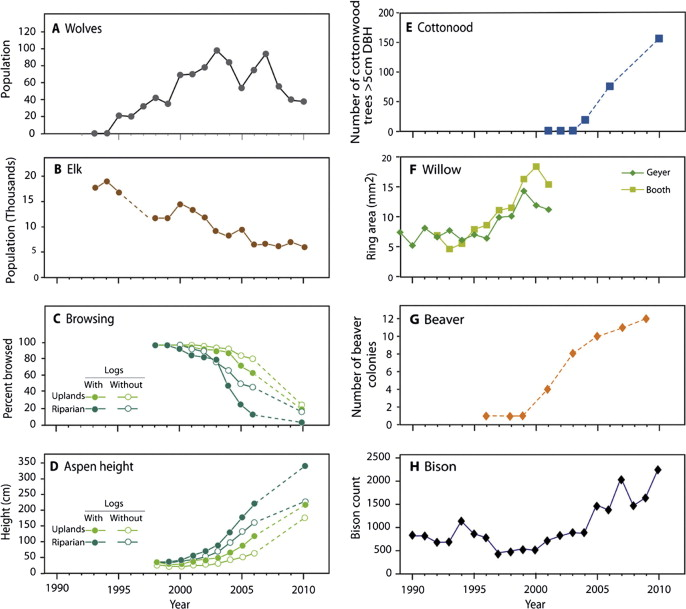

## Bottom-up control: resources can structure communities

 

* **Resources limit primary producers**
    + light
    + nutrients
    + water

 

* **Effects can propagate upward through food webs**

 

* **Top-down and bottom-up control are not mutually exclusive**
    + both can operate in the same community

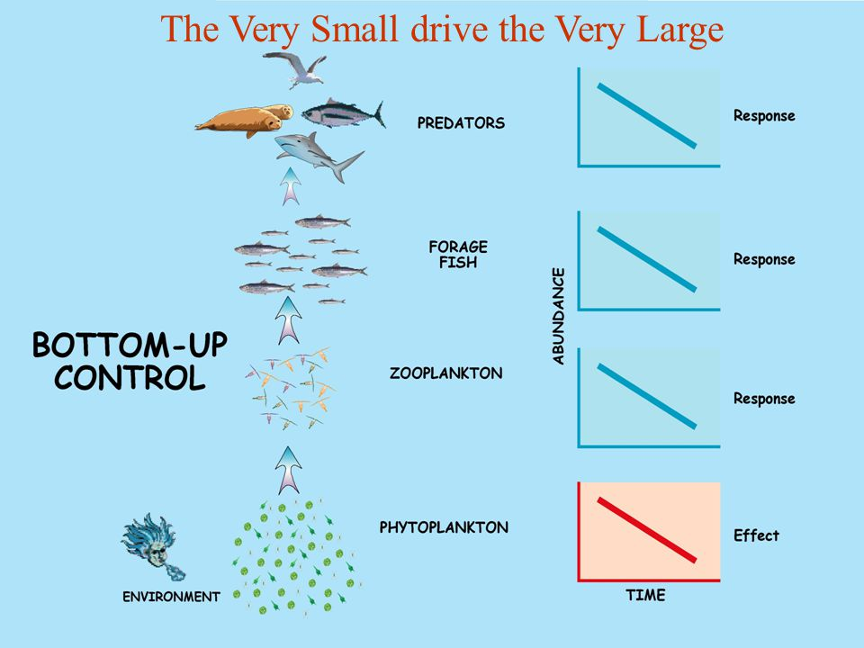

## Succession: community assembly through time

 

* **Succession = change in community composition through time**

 

* **Classic diagrams show a predictable sequence:**
    + pioneer → intermediate → late succession

 

* **But succession is not really a fixed pathway**
    + dispersal
    + environmental conditions
    + species interactions
    + *disturbance history*

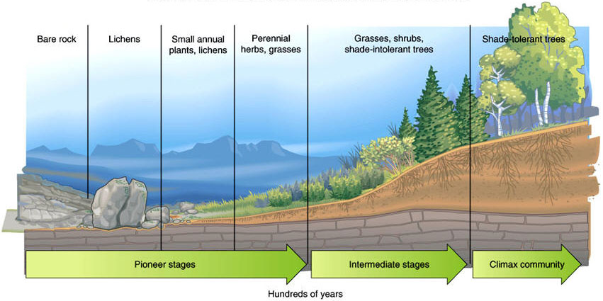

## Disturbance keeps communities in non-equilibrium

 

* **Disturbance = discrete event that alters organisms, resources, or physical conditions**

 

* **Can change:**
    + biomass
    + population sizes
    + species composition
    + resource availability

 

 

* **Most communities experience repeated disturbance**
    + succession is frequently interrupted or redirected

  
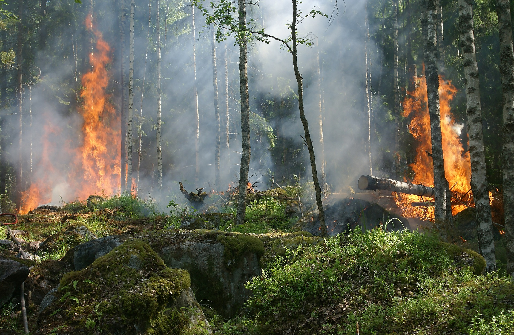

## Disturbance regimes regulate ecological succession

 

* **Frequency**
    + how often?

* **Intensity**
    + physical magnitude?

* **Severity**
    + how much ecological change?

* **Extent**
    + how much area?

* **Duration & timing**
    + how long, and when?

 
 

* **The same disturbance can have very different effects under different regimes**

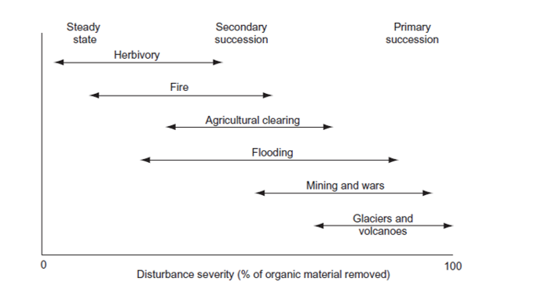

## Disturbance creates a shifting landscape mosaic

* **Different patches can occupy different successional states at the same time**

 

* **A landscape may contain:**
    + recently disturbed patches
    + early succession
    + intermediate communities
    + older communities

 

* **Disturbance can increase turnover among patches**
    + connects succession to *beta diversity*

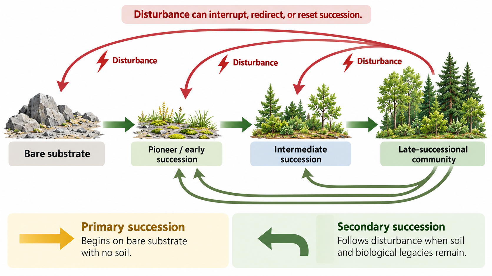

## Primary succession: assembly begins with few biological legacies

* **Begins when disturbance removes soil and established vegetation**
    + lava flows
    + newly exposed glacial surfaces
    + severe sediment deposition

 

* **Colonization requires dispersal**
    + *distance* from source populations matters

 

* **Environmental filtering is strong**
    + high stress
    + minimal soil
    + low nutrient availability

 

* **Early community development is often slow**

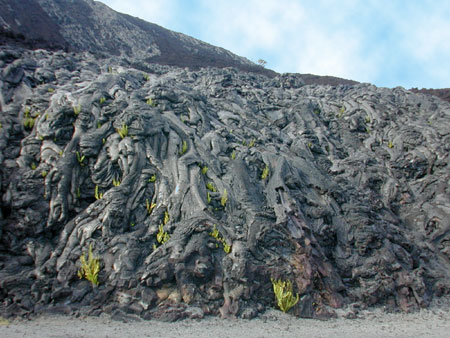

## Succession can proceed through different mechanisms

 

* **Facilitation**
    + early species make conditions more favorable for later species

 

* **Tolerance**
    + later species can establish despite early occupants

 

* **Inhibition**
    + established species suppress later colonists

 

* **More than one mechanism can operate during the same succession**

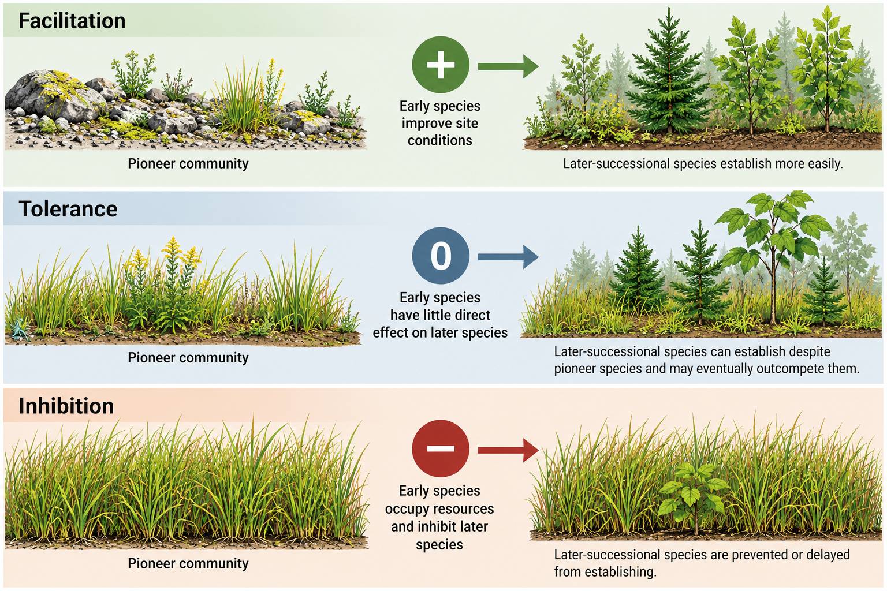

## Secondary succession: biological legacies speed recovery

 

* **Disturbance removes biomass, but important legacies remain**
    + soil
    + nutrients
    + seed banks
    + roots
    + survivors
    + microbes

 
 
 
 
 
 

* **Recovery is less dependent on long-distance colonization**

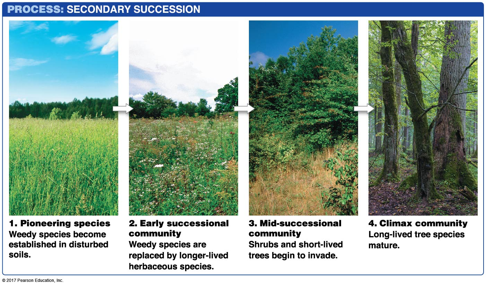

## Pioneer species: traits for rapid colonization

 

* **Rapid potential growth rate**

 

* **Tolerance of exposed conditions**
    + high light
    + variable moisture

 

* **High dispersal ability**
    + often many small seeds

 

* **Earlier reproduction / shorter generation time**

 

* **Pioneer species are a *functional strategy*, not a taxonomic group**

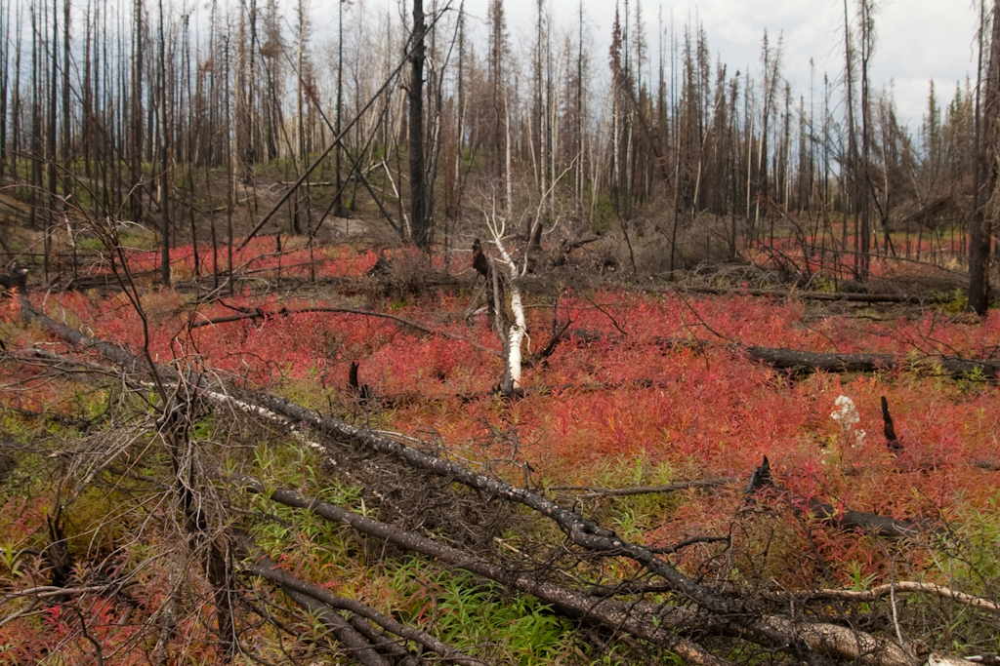

## Priority effects: history can shape the final community

 

* **Priority effect: the order of species arrival changes community development**

 

* **Early arrivals may:**
    + consume resources
    + modify habitat
    + facilitate later species
    + exclude later competitors

 

* **Same environment + same species pool ≠ same community**

 

* **Community structure can therefore depend on historical patterns**

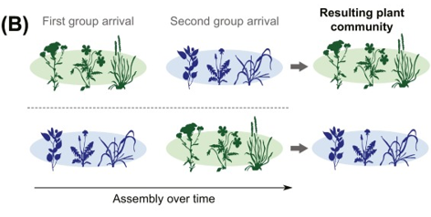

## Late succession does not mean a single predetermined "climax"

* **Shade-tolerant and longer-lived species often increase through time**

 

* **Competition, facilitation, and environmental filtering continue**

 

* **Different histories can produce different mature communities**

 

* **Future disturbance can redirect the trajectory again**

 
 

* **Succession is a dynamic process, not a march toward one perfect endpoint**

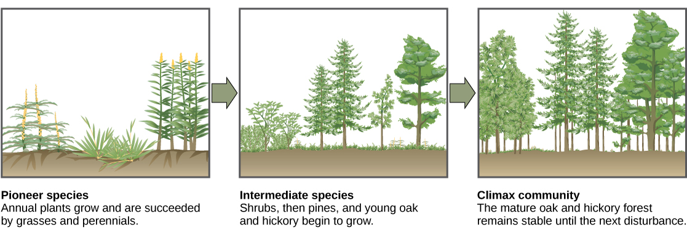

## Testable concepts

 

* **Community assembly and ecosystem stability**
    + dispersal, environmental filtering, biotic interactions, resistance, resilience, and alternative stable states

 

* **Food-web structure and community control**
    + trophic networks, energy transfer, indirect effects, trophic cascades, top-down vs. bottom-up control

 

* **Disturbance and succession**
    + disturbance regimes, primary vs. secondary succession, biological legacies, and landscape mosaics

 

* **Successional mechanisms and historical contingency**
    + facilitation, tolerance, inhibition, pioneer strategies, and priority effects