## The race that changed NASCAR

 
 

* **Daytona 500 — February 18, 1979**

 

* **First live flag-to-flag broadcast of the Daytona 500 on national television**

 

* **A last-lap crash and post-race fight made the finish unforgettable**
    + Richard Petty one after the two leaders crashed

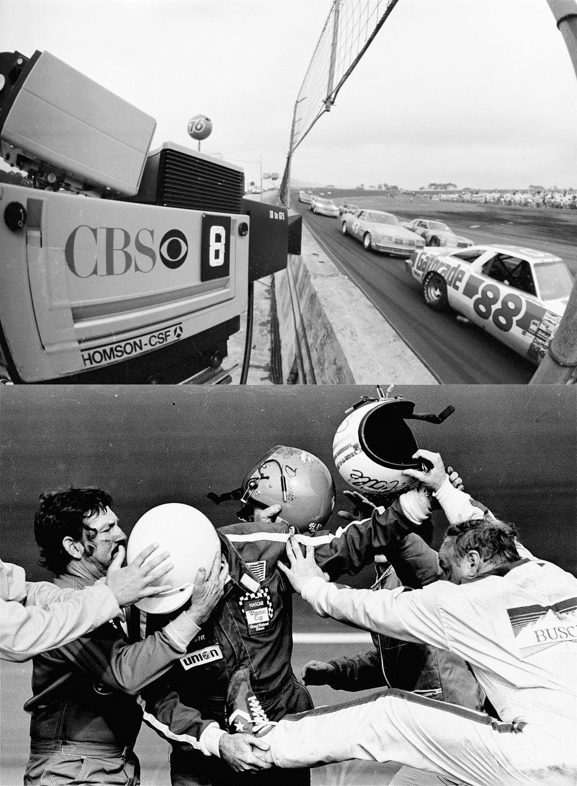

## Why was everyone watching?

* **A monster Presidents' Day snowstorm immobilized much of the eastern United States**
    + millions of people were at home watching television

 

* **The unusual audience helped move NASCAR from a regional sport toward a national audience**

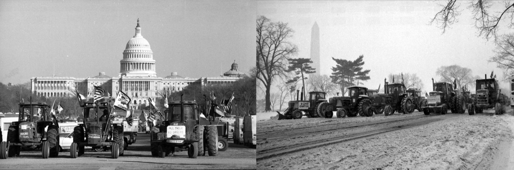

## February 1979 is a Key Date for Climate Change

* **According to NOAA, February 1979 is the last month below the 1901–2000 average**
    + The snowstorm that helped launch NASCAR nationally occurred at the threshold of a remarkable climate streak that has now lasted nearly five decades
    + Since the race, 571 consecutive months have been warmer than that global average

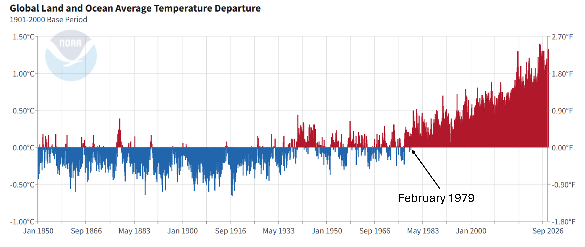

## What do we actually mean by global change?

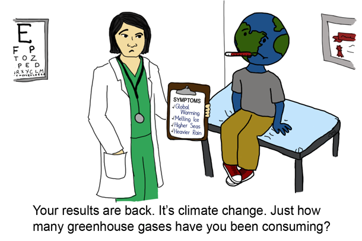

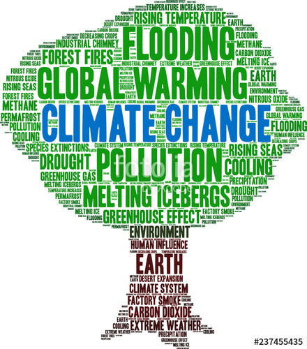

## How warm has Earth become?

 

* **Global temperature varies from year to year, but the long-term trend is strongly upward**

 

* **Recent years occupy the warmest portion of the instrumental record**
    + July 2026 tied 2024 as the warmest July on record
    + August 2026 was the warmest August on record
    + all 10 warmest Augusts have occurred since 2016
    + July 2023, shallow water temperatures in South Florida spiked to 101°F
    
 

* **The important signal is the shift in the climate distribution, not any single record month**
    

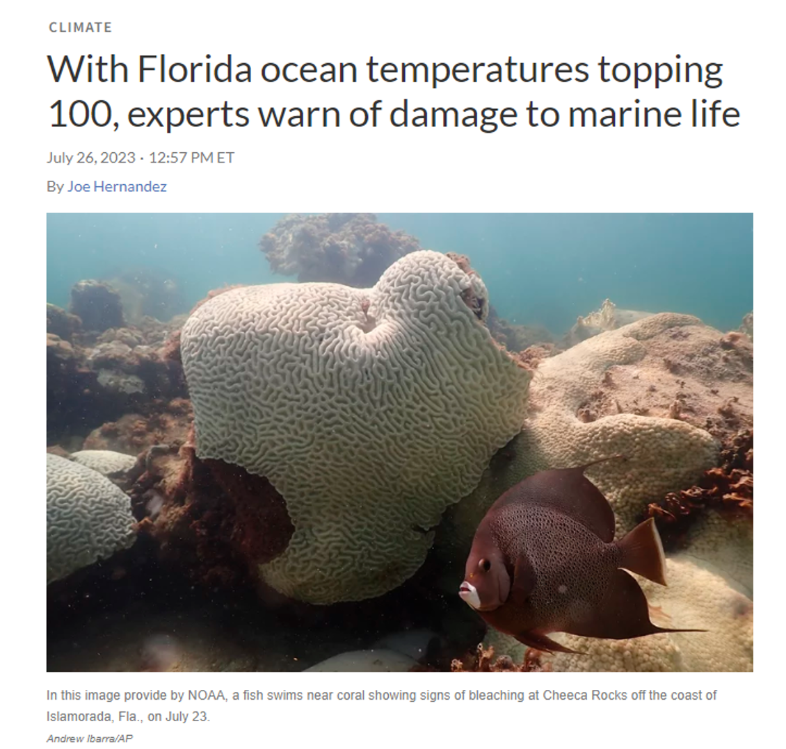

## How warm has Earth become?

<video autoplay loop muted playsinline
       style="position:absolute; top:150px; left:150px; width:800px; height:500px;">
  <source src="https://svs.gsfc.nasa.gov/vis/a000000/a005100/a005190/GISTEMP_Spiral_English_degF_2160p60.mp4"
          type="video/mp4">
</video>

## Physical impacts of climate change are visible

 
 

* **Arctic sea ice expands and contracts seasonally**
    + so year-to-year variation is expected

 

* **September ice extent is best measure for minimum sea-ice extent each year**
    + long-term September minimum has declined substantially during the satellite era
    
 

* **Loss of reflective ice exposes darker ocean water and amplifies warming through albedo feedbacks**

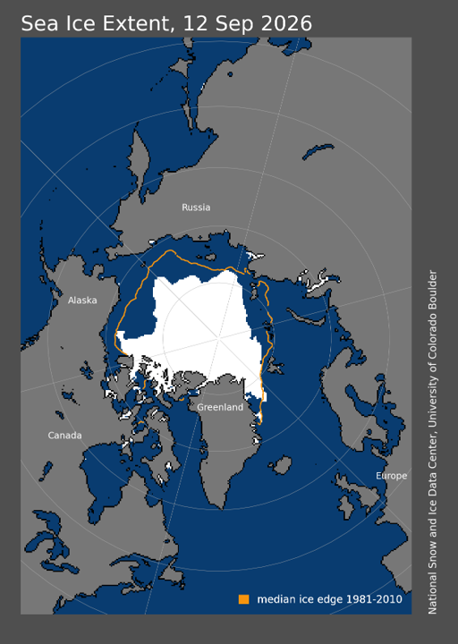

## How do we attribute the warming?

**Attribution asks which causes can reproduce the observed pattern of change**

 
 

* **Greenhouse-gas physics predicts warming when atmospheric CO~2~ increases**

 

* **Natural drivers alone do not reproduce the magnitude and pattern of recent warming**

 
 
 
 

* **Models that include human + natural forcings reproduce the observed trend much more closely**

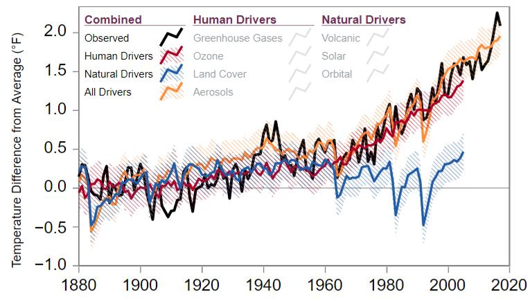

## Atmospheric CO~2~ is changing rapidly

 
 

* **Atmospheric CO~2~ has risen rapidly since industrialization**
    + 1750-1800: 280 ppm
    + September 2026: 426.07 ppm

 

* **Increasing greenhouse gases create a positive energy imbalance in the Earth system**
    
 

* **The rise in atmospheric CO₂ carries a human fingerprint**
    + especially from fossil-fuel combustion

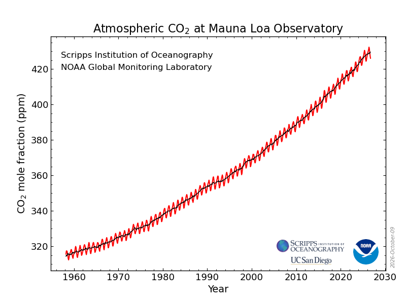

## 

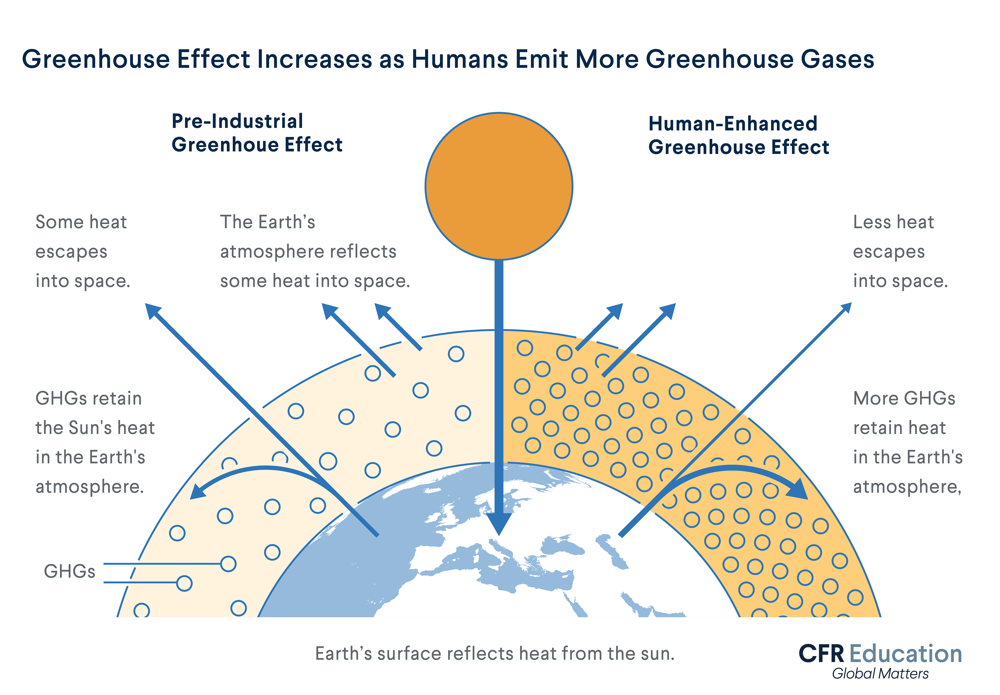

## The argument for humans as the culprit (pop'n = 8.3 billion)

**Human population and resource use changed slowly for most of our history, then accelerated rapidly after industrialization**

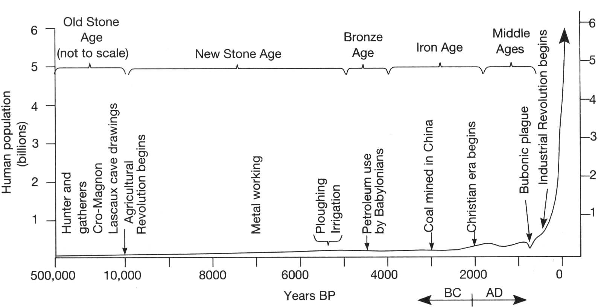

## Humans transformed the Earth system

 

* **Agriculture, fossil-fuel energy, urbanization and technology increased the scale of human influence**

 

* **Haber–Bosch is one example: industrial nitrogen fixation (agricultural fertilizer) greatly increased food production**
    + drove population growth and resource use

 

* **After World War II, many measures of population, energy use, land conversion and material consumption accelerated together**
    + post 1950 = "The Great Acceleration"
    + cultural start of the 'Anthropocene'

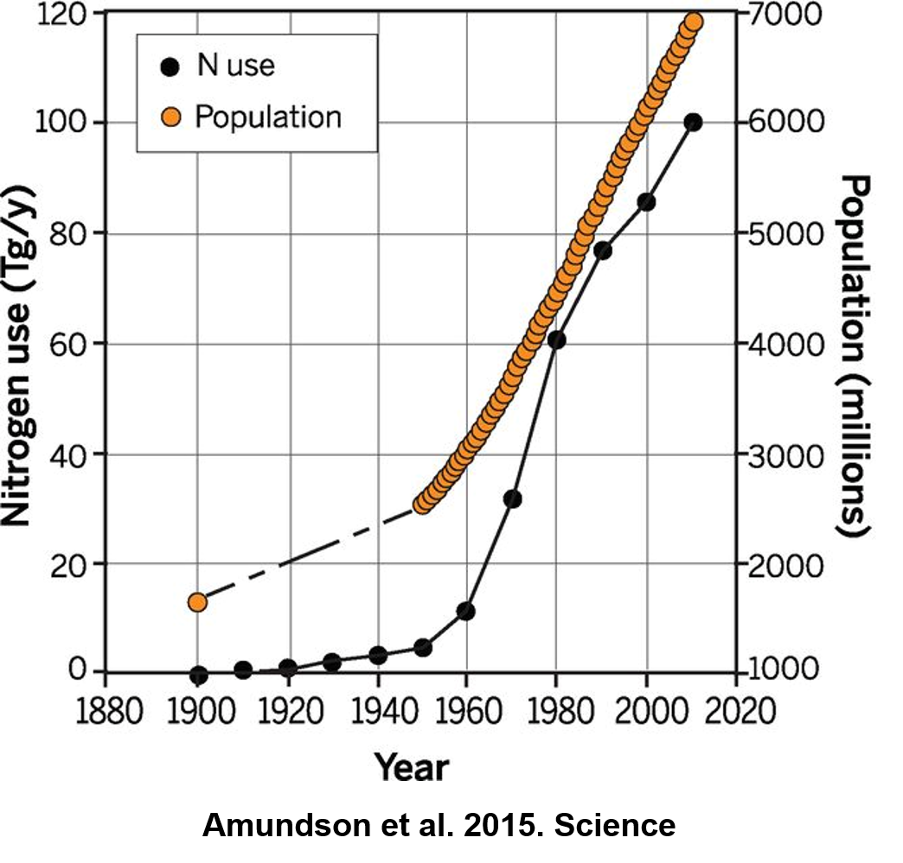

## Cumulative emissions determine warming now and later

* **Greenhouse gases persist in the atmosphere, so warming depends on cumulative emissions**
 
* **Different future emissions pathways therefore produce different levels of warming**

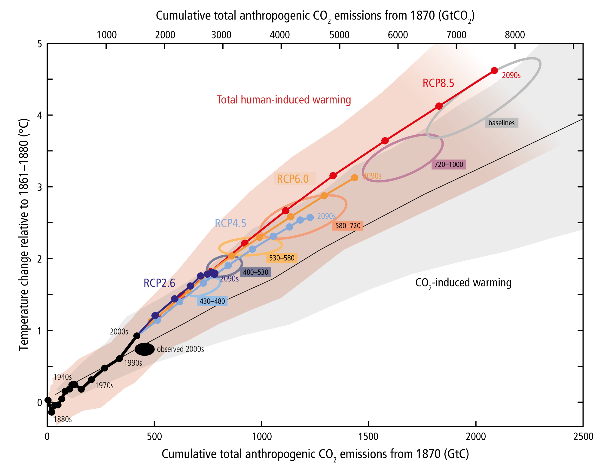

## Feedbacks amplify climate change

* **A *forcing* pushes the climate system away from its previous energy balance**
 

* **A *feedback* changes in response and can amplify or dampen the original change**

 
 
 

* **Forcings can work in either direction:**
    + Positive forcing: more greenhouse gases
    + Negative forcing: volcanic aerosols

 

* **Many important climate feedbacks are positive, meaning they amplify the initial change**
    + water-vapor feedback
    + ice-albedo feedback
    + carbon-cycle feedback

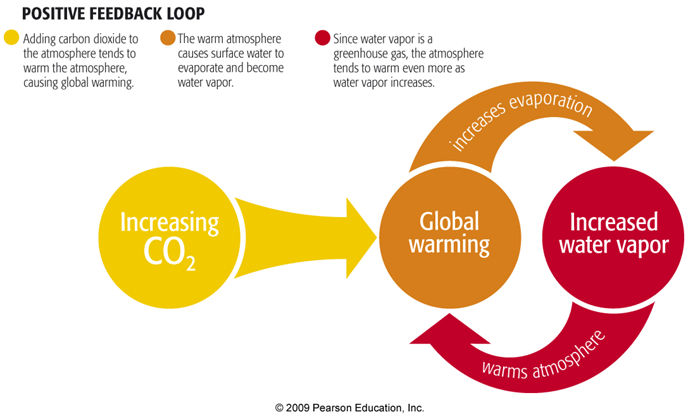

## Global change alters the water cycle

**Warming changes evaporation, precipitation, snow-pack and the timing of water availability**

 
 

* **Water availability is already highly variable across space and time**
    + Climate change is expected to increase hydrologic variability
    
 

* **Water stress alters productivity, species distributions and ecosystem processes**

 

* **Human water withdrawals amplify climatic water stress**

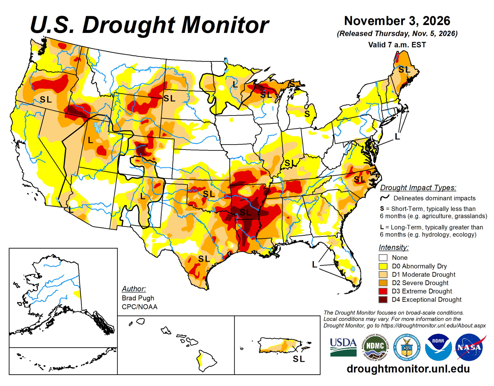

## Global Change: Ocean acidification has multiple feedbacks

**CO~2~ dissolving in ocean water creates carbonic acids, acidifying the oceans**

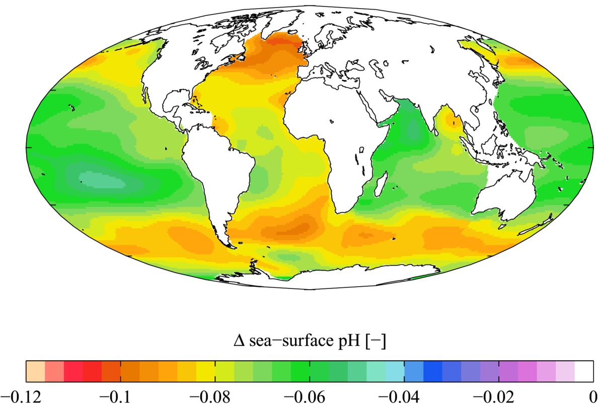

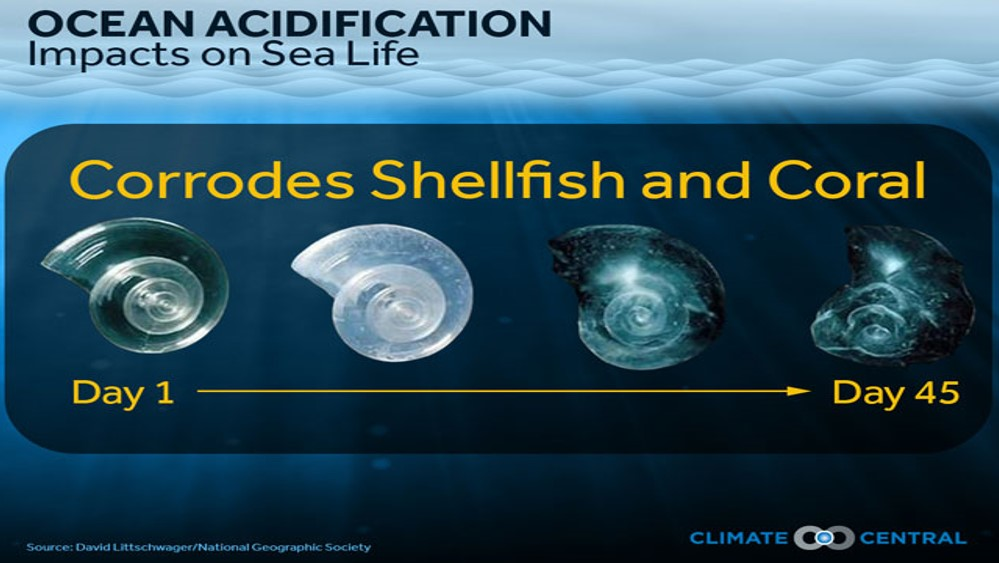

## Sea-level rise

* **Sea level rises through thermal expansion of warming seawater and melting of land ice**
    + rising seas change coastal habitat and increase exposure to flooding and storm surge
    + by mid-century, ~1 billion people are projected to be at risk from coastal climate hazards
    
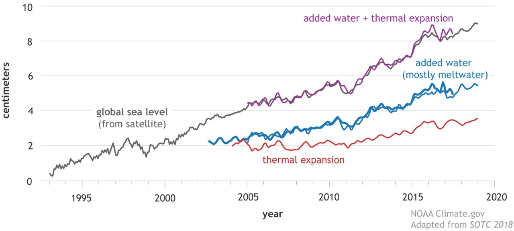

## Humans have transformed Earth's land surface

* **Agriculture, cities, roads and resource extraction alter habitat amount and connectivity**
    + land-use change alters carbon storage, water movement, nutrient cycling and species dispersal

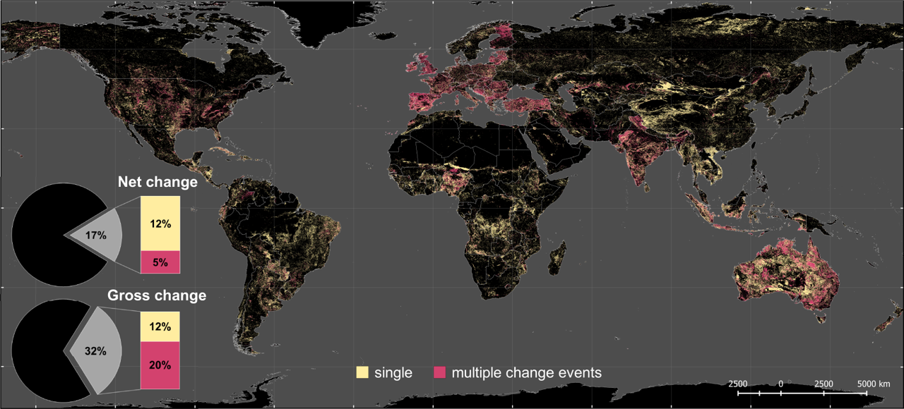

## How can organisms respond to environmental change?

 
 

* **Move: disperse or shift geographic ranges**

 

* **Adjust: acclimation and phenotypic plasticity**

 

* **Adapt: evolutionary change across generations**

 

* **Decline: when environmental change exceeds the capacity to move, adjust or adapt**

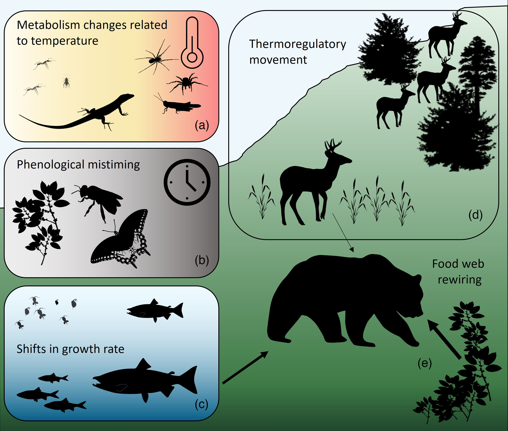

## Global change reshuffles ecological communities

* **Species do not respond to climate change at the same rate or in the same direction**
    + predators, prey, competitors, mutualists and pathogens may gain or lose overlap
    + global change therefore acts as an *environmental filter* during community assembly

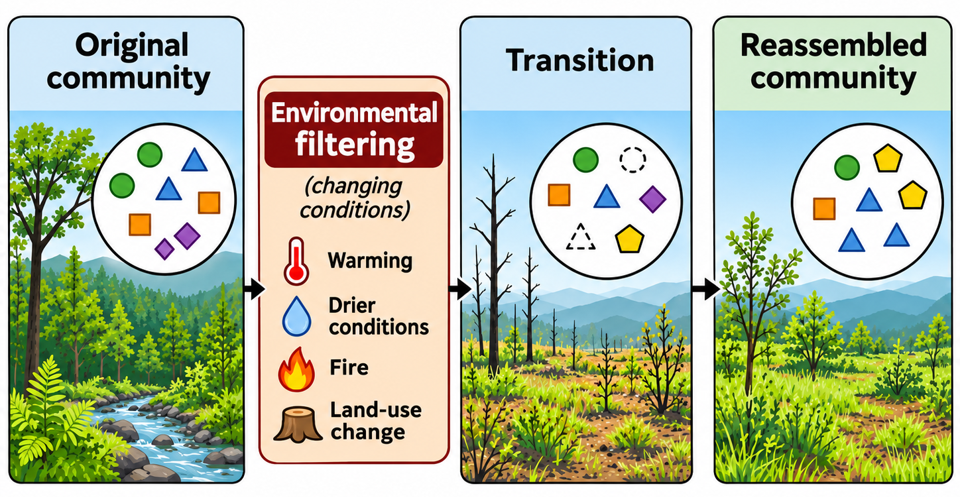

## Will ecosystem function be maintained?

* **Changes in key species or interactions can alter productivity, decomposition, nutrient cycling and foodwebs**
    + In california, warming reduced the tern’s preferred aquatic prey, so the birds shifted toward terrestrial prey. The energy pathway through the food web changed
    
 

* **Community change does not automatically mean ecosystem functions disappear**
    + species resistance and resilience matter

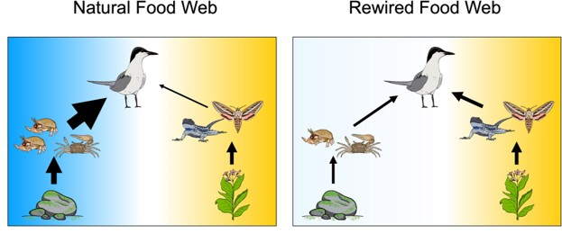

## Humans have a climate niche too

**Humans are organisms with physiological and ecological constraints (but we are not all the same!!)**

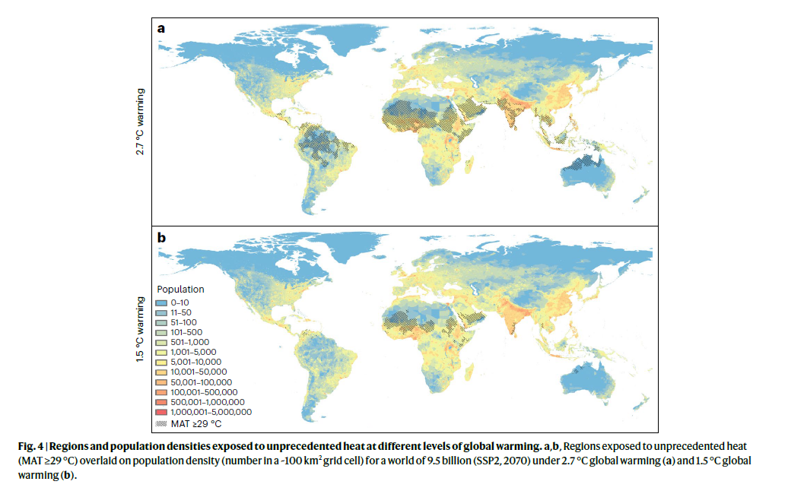

<!-- ## Climate risk is unequal -->
<!-- 
 -->

<!-- * **The same climate hazard does not create the same ecological or human consequence everywhere** -->

<!--   -->

<!-- * **Risk depends on hazard + exposure + vulnerability + capacity to respond** -->

<!--   -->

<!-- * **Responsibility for emissions, exposure to impacts and capacity for adaptation are distributed unevenly** -->

<!-- 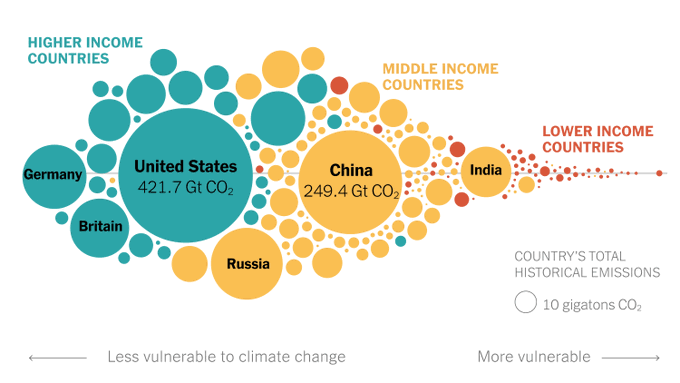 -->

<!-- ## Different choices produce different futures -->
<!-- 
 -->

<!-- * **Future warming depends on the emissions pathway society follows** -->

<!--   -->

<!-- * **Lower emissions reduce the magnitude of future warming and ecological disruption** -->

<!--   -->

<!-- * **Mitigation** changes the amount of future change; **adaptation** changes its consequences** -->

<!--   -->

<!-- * **Carbon removal may contribute, but it does not replace rapid emissions reductions** -->

<!--   -->

<!-- * **International agreements such as Paris provide shared temperature goals, but pathways remain contingent on actions taken** -->

<!--  -->

<!-- NEW IMAGE: Replace the older cop3.png with a current, simple emissions/warming pathways figure from UNEP, IPCC, or Climate Action Tracker. The figure should contrast higher-emission/current-policy pathways with lower-emission pathways. Save as images/emissions_pathways_current.png -->

## Testable concepts

* **Detecting global change**
    + climate anomalies, long-term trends, and natural variability
    + recent warming and Arctic sea-ice decline
 

* **Causes and mechanisms of climate change**
    + evidence used to attribute modern warming to human activity
    + climate forcing versus feedback
    + rising atmospheric CO₂ and cumulative emissions
 

* **Consequences across Earth systems**
    + changing water availability and drought
    + ocean acidification and sea-level rise
    + human alteration of land surfaces
 

* **Ecological responses to global change**
    + movement, acclimation/plasticity, adaptation, or decline
    + environmental filtering and community reassembly
    + humans also occupy a climate niche

